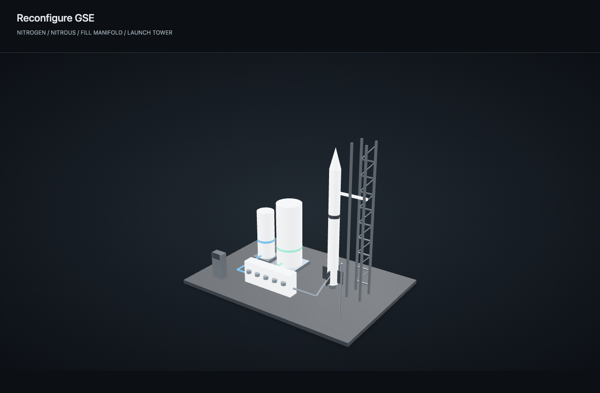

# Ground support equipment sequences

Operator notifications are live events: `Notification` WebSocket messages may
show a five-second popup once. HTTP and `Notifications` WebSocket snapshots only
restore Notification Center history, including notices missed while disconnected;
they never replay popups, even for older entries carrying `persistent: true`.
The backend retains at most 200 recent notices in memory. Closing or expiring a
popup is local and preserves shared history. Warnings and errors retain their
separate persistent acknowledgement behavior.

The Actions tab keeps its original controls and contains the new **GSE sequence
actions** in the main button area. Individual valves remain in the **Manual GSE
valves** group. Ground setup (equipment scene, pressure/noise status, settings and
checklist) appears in both Dashboard/state and Mission before launch. It is removed
from Launch onward, leaving the rocket and flight/recovery information.
Do not operate hardware from this software until
qualified personnel have reviewed the plumbing, command mapping, pressure limits,
and failure behavior, and completed an isolated-gas bench test. Software commands
and board acknowledgements are not independent valve-position feedback. Mechanical
pressure regulation, relief protection and a hardware emergency stop are required.

## Configuration

`GET /api/gse/config` reads settings; `POST` or `PUT` saves them (SendCommands
permission required). `GET /api/gse/status` returns the runtime state (ViewData).
Commands use the existing authenticated WebSocket command channel and action policy.
Configuration persists in `backend/config/gse_sequence.json`, overridable with
`GS_GSE_CONFIG`. Non-HITL operation checks, pressure baseline, cold-flow evidence
and mission stage persist in the adjacent `gse_qualification.json` (`GS_GSE_QUALIFICATION`
overrides it). A restart never resumes a valve sequence, queued QD request or Fire.
HITL retains its runtime-only sequence behavior.

The GSE UI exposes nitrogen maximum pressure, pressure step (default 50 psi),
and the maximum acceptable empty-tank PT offset. The last
increment is capped at the target. Backend administrators configure
`pressure_ceiling_psi` and `grouped_panel` in the backend configuration. The two safety bounds ship unset: automatic operations are unavailable until valid
limits are supplied. Target plus zero allowance must be below the pressure ceiling.
The ceiling is a software trip threshold, not a guarantee against overshoot.
Removing those bounds from the UI does not remove their enforcement.

The **Unlock dry valve self-test** checkbox sits with the main GSE action buttons.
`POST /api/gse/self-test-confirmation` accepts/returns `{"confirmed":true}` or false,
requires command permission and `ValveSelfTest` authorization, and returns 409 during
an active sequence or when trying to unlock after nitrogen testing has started.
Confirmation is not persisted across backend restarts and is consumed by a test.
All existing PT, valve acknowledgement, interlock and sequence gates still apply.
The UI's checkbox must also be checked before its self-test button is enabled.

The ground checklist is a local, per-ground-station operator reminder, retained on
that device when switching views. It has a reset button; reset before each operation.
Checkmarks do not certify hardware state, synchronize across clients, unlock tests,
or bypass backend interlocks.

Calibration opens vent/dump, closes supplies/pilot, waits for acknowledgements, then
collects five seconds of fresh PT samples (at least ten). It records average, min,
max and maximum absolute deviation from the average. Zero is average ± that measured
deviation. Thus 0 ± 3 psi and 5 ± 2 psi are handled without a hardcoded noise floor.
The configured empty-PT allowance bounds the absolute extrema, not just the average;
the latter example requires at least 7 psi. Never enlarge this allowance to teach a
pressurized tank as empty. A PT reading alone cannot establish safe depressurization.

## Actions

### Fill source and automatic loadcell zero

Actions provides a **Fill percentage and automatic cutoff source** selector:
`kg50` (default, signed calibrated 50 kg value) or `kg1000_absolute` (absolute
calibrated 1000 kg value). The selected channel drives both fill percentage and
automatic mass cutoff. Raw and calibrated telemetry/logs retain their original
sign; absolute-value mapping is only for fill control. Changing source clears
the controller's previous mass until a fresh sample from the new source arrives.
Source changes are rejected during an active fill or zero capture.

The selector and both nitrogen/nitrous mass and pressure targets are saved in
`backend/config/fill_targets.json` (`GS_FILL_TARGETS_CONFIG` override). They restore
after restart. Files without a source field default to `kg50`.

The Actions **Automatically zero loadcells** checkbox applies to Start Fill and
HITL/Test Fire Launch. It defaults on, persists in `backend/config/auto_zero.json`
(`GS_AUTO_ZERO_CONFIG` override), and requires command plus calibration-edit
permission to change. It cannot change during fill, launch, or zero capture.
Disabled means use the saved calibration/tare without automatic capture.

- Start Fill checks the selected fill channel's last 200 samples, all received
  within five seconds, with the newest less than 250 ms old. If already stable
  within ±0.8 kg it proceeds immediately through the existing sequence gates.
- Otherwise it collects 200 **new** samples before starting fill. Resuming a
  paused fill never re-tares contents already added. Pause, Cancel, Abort, or
  another accepted manual action cancels a pending fill capture.
- Launch captures the 1000 kg channel concurrently with the existing countdown
  in HITL/test-fire, limited to its first five seconds, without an additional delay.
  Operational builds do not generate automatic GroundStation aborts after Fire
  intent/countdown begins. HITL retains its prior abort/testing behavior.
- The lowest and highest 5% of readings are excluded. The remaining 90% must
  span no more than 0.8 kg, and their mean must remain within ±0.8 kg. Larger
  offsets require inspection/manual tare, not automatic removal of actual load.
- Successful capture saves the trimmed raw mean as the tare without changing
  regression coefficients, then publishes the calibration to DAQ. Missing data,
  movement, calibration changes, or save failures do not start a new fill.

`GET /api/auto_zero` reads and `POST /api/auto_zero` saves `{"enabled":true}`.
The existing `/api/fill_targets` payload now includes `fill_source`.

| Action | Pilot | Vent | Dump | Nitrogen | Nitrous |
| --- | --- | --- | --- | --- | --- |
| Start fill (configuration first) | Closed | Open | Closed | Closed | Opens only after acknowledgements and zero PT |
| Pause fill | Closed | Closed | Closed | Closed | Closed |
| Cancel fill | Closed | Open | Open | Closed | Closed |
| Nitrogen test | Closed | Closed | Closed | Controlled | Closed |
| Self-test completion / nitrogen dump | Closed | Open | Open | Closed | Closed |

The nitrogen test calibrates zero, closes all valves, and follows saved
`nitrogen_steps`, each containing `target_psi`, `settle_ms`, and `hold_ms`.
Targets must ascend, with at most 32 steps; each wait is1–600 seconds and combined
waits are at most one hour. An empty plan preserves legacy `pressure_step_psi`
increments (50 psi by default) through `nitrogen_target_psi` (120 psi by default),
with 2 seconds settling and 5 seconds holding. The final explicit step is the
nitrogen target. Each step closes nitrogen before settling and holding. Rolling averages
filter isolated noisy samples. A drop greater than 3 psi plus the two-reading noise
envelope fails immediately; a sustained five-second mean loss greater than 3 psi
also fails (possibly inconclusive noise), never passes. This is not a certified leak
measurement. Following all holds, dump/vent open; at least a second of samples inside
the calibrated zero band is required before the passed notification and fill unlock.

Self-test requires explicit confirmation that gas supplies are isolated. It opens
one of the five valves, waits for acknowledgement, holds two seconds, then confirms
closure before moving to the next. Ignition and retraction are excluded. Confirmation
is runtime-only and consumed when a test starts. Once nitrogen testing or filling
starts, self-test stays locked. Operational builds preserve successful tests across
restarts until explicit reset; Fire consumes the cold-flow requirement. HITL keeps
its existing runtime-only test status.

An admitted manual valve command cancels pending automation and hands control to
the operator without changing any other valve. Nitrogen qualification and the
nitrous-session hazard latch survive this handoff. Existing command interlocks,
unknown-feedback rejection and fault close-only controls still apply. Incompatible
supply reports still latch a fault after handoff. Editing an effective nitrogen
plan or pressure limits revokes nitrogen and fill qualification; editing fill
precision revokes only fill qualification. Linked checklist completion is cleared
without erasing unrelated manual items. Equivalent legacy/explicit plans retain
qualification. Settings edits are inert and rejected during an active sequence.
Missing/stale PT (2 s), invalid PT, pressure ceiling, lost interlock, command transport
errors, missing acknowledgements (5 s), and step/dump timeouts (60 s) stop sequencing.
Before Fire, faults request supply closure and dump/vent opening. Operational
builds issue no automatic abort or valve correction after durable Fire intent;
this boundary also survives a service restart. Independent board abort latches
and FC autonomous protections remain in force. Verify physical state after any
fault; a network failure can prevent all requested recovery actions.

## Operational workflow (flight launch and test fire)

The persisted mission stages are **Idle → Fill → Armed → Fire**. They are distinct
from the flight computer's ascent/recovery states; no flight-state wire values are
renumbered. HITL does not use this operational qualification policy.

1. Complete valve self-test, then the existing stepped nitrogen test. Successful
   tests complete linked checklist items automatically. The nitrogen test is the
   cold-flow evidence; no new valve pattern is introduced.
2. Start fill with fresh calibrated mass/pressure and stable fill-system routes.
   The accepted automatic mass cutoff and Armed checks use the same tolerance.
   A pressure-plateau stop below the accepted mass target does not arm the system.
3. After a mass-target stop, all valves must acknowledge closed before Armed.
   Paused Fill and Armed retain connectivity protection even if FC reports Idle.
4. Fire rechecks live conditions at dispatch. Flight mode additionally requires
   fresh rocket GPS, FC routes, and QD ACK plus five seconds settling. Test-fire
   has no AV-bay requirement. A launch request during QD settling stays queued.
5. Fire intent is saved before command dispatch. It clears cold-flow qualification
   and its linked checklist items, rejects duplicate Fire, and cannot be replayed
   by a restart. If storage fails, dispatch is refused; if dispatch is incomplete,
   the operator receives a warning and must recover explicitly.

**Override cold-flow requirement** opens a reason dialog. The backend requires a
signed-in operator authorized for `NitrogenTest`, a passed valve self-test with a
saved empty-tank baseline, fresh pressure inside that baseline, both supply valves
confirmed closed, stable connections, interlock, and no active sequence or fault.
The operator, reason and timestamp persist as an override, never a passed test.
It can unlock fill but does not bypass pressure, mass, valve, GPS, route or QD gates.
A later successful nitrogen test replaces it with actual test evidence.

`POST /api/gse/cold-flow/override` accepts `{"reason":"reviewed procedure"}`.
`GET /api/gse/status` includes `mission_stage`, `qualification.nitrogen_override`
and `nitrogen_overridden` alongside actual `nitrogen_passed`. Reset operation
checks from Idle to begin a new cycle. Older version-1 qualification files migrate
without inventing an override or dropping valid evidence.

## Physical panel

`grouped_panel=true` maps the existing five-button cluster as below; LEDs follow the
mapped action policy. Relabel the panel before enabling this mode. Other buttons
retain their existing meanings. `grouped_panel=false` restores individual valves.

| Existing label / BCM input | Grouped action |
| --- | --- |
| Pilot / 13 | Valve self-test |
| Nitrogen / 23 | Nitrogen test |
| Nitrous / 17 | Start fill |
| Vent / 20 | Pause fill |
| Dump / 12 | Cancel fill |

## Models

The included unbranded GLB scene depicts nitrogen/nitrous tanks, manifold, plumbing,
launch tower and vehicle. Valve colors reflect last acknowledged state, not measured
flow. Animated `nitrogen-test`, `nitrous-fill`, and `dumping` clips indicate sequence
activity only. These illustrative models are not engineering CAD or tank-level data.
Regenerate with `(cd ui && node scripts/build_gse_models.mjs)`. The built-in
rocket has one stage and aft fins. GLB profiles and named-node animation are
used for saved telemetry replay; live Dashboard and audience views use 2D art.
See [model configuration](model-animations.md).

The equipment preview's bundled model-viewer 4.3.1 is Apache-2.0 licensed; see
the frontend's [model-viewer license](https://github.com/Rylan-Meilutis/Seds-Ground-Station-Frontend/blob/main/station_ui/vendor/model-viewer.LICENSE). Built-in uncompressed models require
no CDN. The replay renderer uses bundled Three.js (MIT).
Uploaded models using compression may need additional decoder assets.
# HITL button availability

HITL sequence requests are permitted throughout Startup, Idle, PreFill, FillTest,
NitrogenFill, NitrousFill and Armed. Launch and later (and Aborted) disable them.
This flight-state allowance does not bypass engine prerequisites: fresh telemetry,
pressure limits, nitrogen-test completion before fill, and self-test confirmation
remain required. Enabled sequence buttons are illuminated as a readiness indicator;
backend `actuated` still reports actual sequence status, not mere availability.

The backend layout now includes all five GSE sequence action definitions and
adds their command IDs to prelaunch state widgets that contain manual valves.
They therefore appear both in Actions and in the embedded ground-station valve
control panels; manual commands remain available. Layout normalization is
idempotent and applies to regular, HITL, test-fire and custom layouts.
Authorization, action-policy enablement and self-test confirmation are unchanged.

HITL adds illuminated `ToggleGroundStationControl` (**Ground station control**),
default ON on backend restart. It is an authenticated command like Button
Interlock; its state is authoritative in the action policy. It controls automatic
cutoff for the one-button Start Fill, not arbitrary manual valve actions.
Regular/test-fire one-button fills always use automatic cutoff.

The cutoff uses the main fill's signed nitrous mass target. Saved
`fill_overfill_kg` defaults to 0.05 kg and is capped at 0.1 kg. At that threshold,
supplies, pilot, vent and dump are physically confirmed closed in sequence.
`fill_settle_ms` defaults to 3000 ms (1–600 seconds). After settling, a fresh stable
one-second mass window must meet `fill_tolerance_kg` (default and maximum ±0.07 kg).
An overweight result opens only the vent for an ACK-timed 100 ms pulse, closes it,
then settles again. At most 20 pulses are allowed; an underweight or unstable
result remains unqualified. Completion requires closed valve reports, never
merely transport delivery or an open vent. The old 99.5%/plateau heuristic does not
qualify this precision-fill path; the separate legacy procedure is unchanged.

Fresh calibrated mass and PT data are required (at most 2 seconds old). Network-UTC
capture age is retained rather than reset at receipt; repeated captures cannot
renew freshness or form a settled sample. A clock lead of at most 100 ms is clamped
to receipt time; materially future or older-than-2-second captures are excluded
from control, without removing display/history/export records. Unsynchronized
boot timestamps retain receipt compatibility. Physical valve reports use the
same source-age guard before acknowledging an automated target. Faults retain the
existing emergency supply-close and dump/vent-open policy without waiting for ACKs.
HITL Ground station control OFF disables automatic mass cutoff only; other
interlocks remain active and the operator must stop fill.

The action panel places sequence actions first and groups Igniter/Igniter Sequence
with manual valve controls. Only Valve Self-test uses the confirmation checkbox.
In HITL, sequence request buttons follow the manual-button interlock; they do not
require a successful nitrogen test, fresh PT, or configured pressure limits merely
to be clickable. This is **not** an execution bypass: the backend engine validates
all normal prerequisites before emitting any valve commands and reports a rejected
start as a notification. Regular and test-fire builds retain sequenced availability.
Missing pressure ceiling/empty-tank offset limits must still be configured by the
backend operator; clicking a button does not supply or override them.
# HITL operator recovery

The Actions tab includes two independent, confirmation-protected recovery controls:

- **Reset flight state to Idle** updates the shared, persisted flight-state network
  variable through the normal backend path. It does not reset the T-clock or
  close valves. Verify the physical system is safe before using it.
- **Reset T-clock** clears the displayed launch-clock anchor without changing
  flight state, recorded telemetry, calibration, or physical board sequences.

Normal command authorization and button interlocks still apply. These are not
  substitutes for Abort, and do not cancel a launch sequence running on a board.

## Clearing abort

The on-screen **Clear GSE abort** button is available while the shared flight
state is Aborted, in GSE actions and the State view. It has no physical-panel
mapping. It requires command permission and explicit confirmation, and refuses
an active sequence. Recovery persists and publishes Idle so reconnection uses
the replacement shared state, clears the local sequence fault and resets
operation checks. It preserves the T-clock and sends no output commands or
automatic startup valve sequence. Repeat self-test and nitrogen test before fill.

This does not clear a board-local abort latch. Clear GroundStation first, then
remove all power from affected GSE boards before reconnecting them. The updated
valve and actuator firmware retain their abort through software/watchdog/NRST
resets while continuing communication. A retained latch clears when the hardware
backup domain loses power, including any separate VBAT or USB/backfeed supply.
