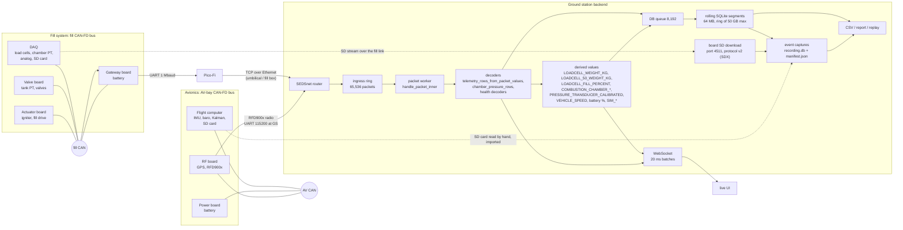
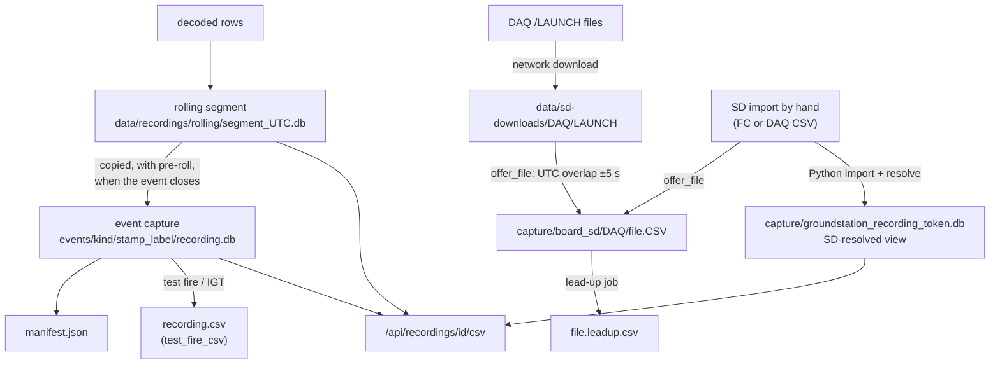

# Ground station data pipeline

This document traces data from every board to the ground station (GS), through
decoding and derived values, to the live UI and to everything the GS keeps on
disk. Each rate, buffer, path and data type is cited to the code that sets it.

Code references are to `backend/src/` unless another path is given. Board
references are to the sibling firmware repositories, read at `origin/dev`:

| Repo | Commit |
| --- | --- |
| DAQ-Board | `6f29611` |
| FlightComputer26 | `659440e` |
| ValveBoard26 | `b641993` |
| ActuatorBoard26 | `25e19bb` |
| gateway-board26 | `87f824e` |
| RFBoard26 | `a2fc87f` |
| PowerBoard26 | `22250a7` |

Related pages:

- [backend/rolling-recording.md](backend/rolling-recording.md): the store and its API.
- [backend/data-capture.md](backend/data-capture.md): exports.
- [backend/sd-network-download.md](backend/sd-network-download.md): board SD download.
- [backend/daq-launch-logging.md](backend/daq-launch-logging.md): `DAQ_LOG_CLOCK`.
- [integrated-ground-test.md](integrated-ground-test.md): the integrated ground test (IGT).

## 1. Overview



**Links.** `backend/comms/comms.json` sets up two links:

- `av_bay`: serial `/dev/ttyAMA0` at 115200 baud, `raw_uart`, to the RFD900x radio.
- `fill_box`: `pico_fi_tcp`, which reaches the gateway's Pico-Fi over Ethernet.

On the fill side:

- The gateway bridges its CAN side to Pico-Fi over a 1,000,000-baud UART (gateway-board26 `CMakeLists.txt:77`).
- Under receive pressure, the gateway ring drops best-effort KG1000, KG50 and OX_TANK_PRESSURE (formerly FUEL_TANK_PRESSURE) frames first (gateway-board26 `Core/Inc/can_rx_admission.h`).

On the avionics side, the RF board has two router sides, `can` and `radio` (RFBoard26 `Core/Src/telemetry.c`).

The DAQ, VB, AB and gateway never use the radio. The FC, PB and RF never use the fill link.

## 2. What the GS receives

### 2.1 Ingest path (all boards)

| Stage | Size / period | Behaviour when full | Source |
| --- | --- | --- | --- |
| Router to ingress ring | 65,536 packets (`GS_RING_BUFFER_CAPACITY`, 1,024 to 1,000,000) | drops the oldest packet and counts it; warns (at once, then at most every 30 s); counts in `/api/network_diagnostics` `ingress_ring` and every `REC_NETWORK_STATE` row | `main.rs:1536`, `ring_buffer.rs` `RingBuffer::push`, `DropWarning` |
| Ring to packet work queue | 256 packets per 1 ms tick (`GS_PACKET_ENQUEUE_BURST`); queue 8,192 (`GS_PACKET_WORK_QUEUE_SIZE`) | stops moving packets; logs "Telemetry ingest backpressured" | `telemetry_task.rs:49-50`, `:1026`, `:1820` |
| Packet worker to DB queue | 8,192 items (`GS_DB_WORK_QUEUE_SIZE`) | telemetry rows wait (`send().await`); health rows are dropped (`try_send`) | `main.rs:1499`, `telemetry_task.rs` `queue_db_write`, `telemetry_task/recording_diagnostics.rs` `raw_health` |
| DB batch | up to 256 rows or 8 ms (`GS_DB_BATCH_MAX`, `GS_DB_BATCH_WAIT_MS`) | n/a | `telemetry_task.rs:52-53`, `telemetry_task/recording_owner.rs` |
| Live cache | 20 min or 250,000 rows | drops the oldest rows | `state.rs` `cache_recent_telemetry` |
| WebSocket per client | flush every 20 ms (`GS_WS_TELEMETRY_FLUSH_MS`); at most 256 rows per flush (adaptive, starting at 192, minimum 64); pending cap 16,384 | drops the oldest rows | `web.rs:5553-5577`, `:5995-6038` |

Every recorded row has two timestamps:

- `timestamp_ms`: the GS clock when the packet worker processed the packet (`get_current_timestamp_ms()`, `telemetry_task.rs:3130`).
- `source_timestamp_ms`: the board's packet timestamp.

Captures, CSV export and report windows all use `timestamp_ms` (Section 5).

### 2.2 DAQ (fill CAN, then gateway, then Pico-Fi)

The DAQ caps sensor packets at `DAQ_NETWORK_RATE_HZ 100`
(DAQ-Board `Core/Inc/daq_network_config.h`, `daq_network_schedule.h`):

- Every fast-pair bin (KG1000 + chamber PT, 20 ms, 50/s) and every KG50 bin
  (50 ms, 20/s) gets a slot, dated at the bin centre.
- Temperature, SDADC, SAR, current and power share the remaining ≥ 30 slots/s
  by weight 1/2/1/1/2; each keeps only its latest value.

The DAQ converts KG1000 and the chamber PT at 1 kHz and KG50 at 800–900/s; the
packets carry the mean of each bin of a 3- (fast) or 5-sample (KG50) running
median. Every conversion is on the DAQ SD (DAQ-Board `docs/data-pipeline.md`).
Health types bypass the cap.

| SEDSnet type | Payload | Rate at GS | GS decoder | Rows recorded and shown | Units |
| --- | --- | --- | --- | --- | --- |
| `KG1000` | f32[1]: 20 ms bin of the 3-sample median of the 1000 kg cell | 50/s, shared with `DAQ_LOADCELL_CHAMBER` | generic f32 path (`telemetry_task/derived.rs` `telemetry_rows_from_packet_values`) | `KG1000`; derived `LOADCELL_WEIGHT_KG`; `LOADCELL_FILL_PERCENT` when the fill source is KG1000 | ADC-pin V; kg; % |
| `DAQ_LOADCELL_CHAMBER` | f32[3]: [KG1000, chamber psig, chamber connector V], both 20 ms bins of the same centre. Sent in the KG1000 slot when the chamber bin matches | 50/s, shared | `telemetry_task/derived.rs` `chamber_pressure_rows` | raw `DAQ_LOADCELL_CHAMBER`, `KG1000`, `COMBUSTION_CHAMBER_PRESSURE`, `COMBUSTION_CHAMBER_VOLTAGE`, `COMBUSTION_CHAMBER_RANGE_STATUS`, `COMBUSTION_CHAMBER_PT_INSTALLED`, plus the KG1000 derived rows | V; psig; V; 0/1 |
| `KG50` | f32[1]: AMP2 (CH1), 50 ms bin of the 5-sample median | 20/s, shared with `DAQ_KG50_SELECTED` | `loadcell::selected_kg50_value` | `KG50`; derived `LOADCELL_50_WEIGHT_KG`; `LOADCELL_FILL_PERCENT` (default fill source) | V; kg; % |
| `DAQ_KG50_SELECTED` | f32[2]: [source, value]; source 1 = P6 differential | 20/s, shared. Sent instead of `KG50` when the DAQ input is not AMP2 (`Core/Src/daq_thread.c` `daq_offer_live_report`) | `loadcell::selected_kg50_value` | recorded as `KG50` (8-byte payload); same derived rows | V |
| `DAQ_ADC_TEMPERATURE` | f32[1] | ≈ 4/s (interleave weight 1) | generic | `DAQ_ADC_TEMPERATURE`; also read by `loadcell::recent_adc_temperature` (2 s freshness) | °C |
| `DAQ_SDADC_VOLTAGES` | f32[6]: CH2, CH3, CH4, CH5, HVAIN1, HVAIN2 (latest 3-sample medians; HVAIN1 = chamber 20 ms bin) | ≈ 8/s (weight 2) | generic; DAC check `daq_dac::observe_values` | as received | connector V (HVAIN includes the 11x divider) |
| `DAQ_SAR_VOLTAGES` | f32[8]: SAR_IN1..8 | ≈ 4/s (weight 1) | generic; `daq_dac::observe_values` | as received | V |
| `DAQ_CURRENT_SENSE` | f32[4]: J7 V, J8 V, J7 A, J8 A | ≈ 4/s (weight 1) | generic | as received | V, A |
| `DAQ_POWER_MONITOR` | f32[4]: VMON V, IMON V, VMAIN V, input A | ≈ 8/s (weight 2) | generic | as received | V, A |
| `DAQ_INPUT_HEALTH` | u32[28], version 3 (layout in `daq_input_health.rs` header; version 2 u32[18] and version 1 u32[10] still decode from recordings): faults (8 VDDA_HIGH, 9 VDDA_LOW added in v3) plus per-channel noise/drift, excitation mV, ADC frame counters, ADC over-range now/latched/direction masks and per-channel counters, VDDA (+3V3A) max/now, applied MCP3564R reference | 1/s, at most every 200 ms (`DAQ_INPUT_HEALTH_PERIOD_MS`, `Core/Inc/daq_input_fault_config.h:131`) | `network_health::observe_input_health`, `daq_input_health::observe_alerts` | raw payload row, `values_json` `[]`; alerts; Board status `daq_input` (`adc_channels`, `vdda_v`, `vdda_max_v`, `mcp_vref_v`, `mcp_vref_source`) | mV fields |
| `DAQ_SD_HEALTH` | u32[8] | every 5 s | `network_health::observe_sd_status` | raw payload row | |
| `DAQ_LAUNCH_LOG_STATUS` | u32[7] | every 5 s | `network_health::observe_launch_log_status` | raw payload row; `/api/network_topology` `launch_log` | |
| `DAQ_DAC_STATUS` | u8[80] | while the DAC runs | `network_health::observe_dac_status`, `daq_dac::observe_status` | raw payload row | |
| `BOARD_HEALTH` | u32[24] | every 5 s (all boards) | `network_health::observe_diagnostics_with_source`; DAQ `board_config_sync::observe_daq_health` | raw payload row | |

Any `KG1000`/`KG50` sample from the DAQ also feeds the tare and auto-zero
tracker. The sample must be fresh: its source age must be between -100 and
2,000 ms when both clocks are UTC (`telemetry_task.rs`, after `:3243`).

The GS sends these to the DAQ (endpoint `SD_CARD`), all from `network_variables.rs`:

- `DAQ_LOADCELL_CALIBRATION`, `DAQ_KG50_CALIBRATION` (`loadcell::kg50_daq_coefficients`), `DAQ_THERMAL_CALIBRATION`, `DAQ_FILTER_CALIBRATION`.
- `DAQ_KG50_INPUT`.
- `DAQ_LOG_CLOCK`.
- `DAQ_SD_RETRY`.

#### Load-cell conversion (`telemetry_task/derived.rs` `prepare_derived_loadcell_rows`)

The steps run in this order:

1. **Rail check.** `loadcell::loadcell_volts_at_rail` withholds the weight (`None`) when the input is clipped. The limits are:
   - KG1000: at or below 0.0434 V, or at or above 2.4 V.
   - AMP2 KG50: ±2.4 V.
   - P6 KG50: ±0.15 V.

   The first sample of a clipped episode raises an alert, then nothing for a 30 s holdoff (`LOADCELL_RAIL_ALERT_HOLDOFF_MS`).
2. **Thermal offset.** `loadcell::temperature_corrected_raw` subtracts `raw_per_c × (T − reference)`. It applies only when a thermal entry exists with a nonzero slope. The shipped `backend/calibration/loadcell_calibration.json` has no `thermal` entry.
3. **Low-pass filter.** `loadcell_zero::Service::filter` applies a first-order low-pass, `alpha = dt / (tau + dt)`, with `tau` from `noise.<sensor>.tau_ms` (0 to 2,000 ms). It uses DAQ samples only, and resets when the gap exceeds 2 s.
4. **Fit.** `loadcell::calibrated_sensor_value` evaluates a linear fit or a poly2/3/4 fit in `x − x0`, minus the fit's value at the zero point. Channels: `ch1` (KG1000), `kg50`, `iadc` (tank PT).
5. **Fill mass and percent.** Mass is the calibrated kg of the fill source: `fill_targets::FillSource`, default `Kg50`; `Kg1000Absolute` uses `|kg|`. `loadcell::fill_percent` gives `clamp(100 × mass / target, 0, 100)`. The target is `nitrogen.target_mass_kg` in PreFill, FillTest and NitrogenFill, and `nitrous.target_mass_kg` otherwise (`loadcell::active_fill_target_mass_kg`; defaults 0.5 kg and 8.0 kg in `backend/config/fill_targets.json`). KG50 drives no mass until a `kg50` calibration exists.
6. **Calibration snapshot.** A `calibration_history` row (`DbWrite::Calibration`) is written per sender and sensor when the configuration changes, and otherwise every 10 s (`emit_derived_loadcell_rows`).

#### Chamber PT (`chamber_pressure_rows`)

- The DAQ computes psig (connector V × 200, PX309-1KG5V). The GS only forwards it, after these checks:
  - |psig| ≤ 5,280 and |V| ≤ 26.4 are required.
  - `RANGE_STATUS` = 1 outside 0 to 1,000 psig or 0 to 5 V.
- With `chamber_pt_installed = false`, pressure and status are recorded as `null` and `PT_INSTALLED` as 0. The raw vector is still recorded.

#### Over-range values (`over_range.rs`)

The MCP3564R has no over-range status bit. The DAQ classifies a conversion
as over range when |code| > 2^23 − 1 (beyond ±VREF/GAIN; accuracy holds
only to about ±1.05 × VREF and codes clip at ±2 × VREF, DS20006391C §5.6).

- **Wire.** A published value whose whole bin was over range is +Inf (above
  +full scale) or −Inf (below −full scale). A bin with some in-range samples
  carries the mean of those only. NaN still means no data. This applies to
  `KG1000`, `DAQ_LOADCELL_CHAMBER` [0..2], `KG50`, `DAQ_KG50_SELECTED` [1] and
  `DAQ_SDADC_VOLTAGES` [0..5]. `DAQ_ADC_TEMPERATURE` goes NaN instead.
- **Station pipeline.** For those DAQ types the ±Inf markers are kept
  (`telemetry_f32_values_marked`). A derived row from an over-range input is
  over range as well: `LOADCELL_WEIGHT_KG`, `LOADCELL_50_WEIGHT_KG`,
  `LOADCELL_FILL_PERCENT`, and `COMBUSTION_CHAMBER_PRESSURE`/`_VOLTAGE`/`_RANGE_STATUS`.
  No number is ever computed from a marker, and the fill mass reads `None`.
- **Rows.** `TelemetryRow` (WebSocket, `/api/recent`, the NDJSON stream),
  replay samples and raw-stream rows carry the value as `null` plus
  `over_range` (bit i: `values[i]` is over range) and `over_range_low` (bit
  i: below −full scale). Both are omitted when 0.
- **Recordings.** `values_json` holds `null`, and the nullable column
  `telemetry.over_range` holds `mask | low_mask << 32` (also
  `sd_replay_telemetry.over_range` for SD-resolved rows). Recordings made
  before this have no such column; readers treat it as absent. Copies (ring
  windows, captures) carry the column when both sides have it.
- **CSV.** The recording CSV writes `"OVR"`/`"-OVR"` in `values_json`. The
  test-fire CSV writes `OVR`/`-OVR` in the value and weight cells.
  `export_telemetry_csv.py` adds the packed `over_range` column.
- **Excluded from.**
  - Known-mass/zero captures: refused with "KG1000 over range during the
    capture (n samples); fix the input and repeat". The check covers
    `capture_started_ms`, or else the last 10 s.
  - The thermal zero, over its 132 s settling window.
  - The long zero/noise capture (`loadcell_zero`), which is refused.
  - Auto-zero: an over-range sample in the window blocks the zero, with a
    reason.
  - The burn report: up to 2 samples / 5 ms are bridged. Longer stretches
    are a `kg1000_over_range` / `kg50_over_range` gap, with
    `impulse_lower_bound` and `over_range_gap_s` set; `chamber_over_range`
    is flagged too. Such a fire joins the archive excluded from the motor
    fit until it is reviewed.
- **Alerts** (`daq_input_health.rs`, DAQ_INPUT_HEALTH v3).
  - A channel going over range warns once per episode with a 30 s holdoff,
    e.g. "DAQ ADC over range: KG1000 (CH0) for 1.0 s (…)". The chamber PT
    over range inside the burn window (T0 − 1 s to T0 + 20 s on the station
    launch clock, PT installed) is CRITICAL: "overpressure or sensor fault".
    So is any channel in `TANK_PRESSURE_BITS` (empty: the tank PTs are on
    the VB).
  - VDDA_HIGH warns "DAQ +3V3A high (x.xx V): likely clamp injection …" and
    names the channels over range at the time. Above 3.6 V it is CRITICAL:
    "exceeds the 3.6 V operating limit; hardware stress risk".
  - VDDA_LOW warns.
  - While VDDA_HIGH is active, the VMAIN supply-low alert notes that VMAIN
    is now VDDA-corrected. The earlier ~11 V dips were most likely a VDDA
    measurement artifact.
  - The DAQ_POWER_MONITOR values arrive already VDDA-corrected; the station
    does nothing further.
  - The Board status lists every channel that is over range now or was in
    the last 10 minutes (`adc_channels`). Its counts are accumulated by the
    station from the wrapping u16 counters.

#### MCP3564R reference (`DAQ_MCP_REFERENCE`, `loadcell/mcp_reference.rs`)

The DAQ publishes every MCP3564R input as volts = code × VREF / 2^23. The P6 ×16 scan is divided by 16 again. VREF is a per-station DAQ setting that the GS owns.

- **Setting.** `mcp_vref_v` (f32 volts) in the load-cell calibration file, with the free-text `mcp_vref_note`. The default is the nominal 2.4 V, and the valid range is 1.9–2.6 V, which the DAQ also enforces. `GET /api/calibration` returns both fields. `POST /api/calibration/mcp_vref` with `{"mcp_vref_v": x}` saves the value; an optional `"note"` sets the note, and leaving it out keeps the current one. The reply echoes `mcp_vref_v`, `mcp_vref_note`, `nominal_v`, `min_v` and `max_v`. A change is refused while a zero capture or a recording is running.
- **Sending.** `DAQ_MCP_REFERENCE` is 4 bytes, f32 LE, to `SD_CARD`. It is a managed station variable like `DAQ_KG50_INPUT`. The DAQ requests it every boot until it has it. `set_daq_calibration` sends it first, then the calibrations. The value is per calibration file, so per station mode. Set it in each mode's file that drives the real DAQ (normal and test fire), and on both paired stations: a paired peer refuses calibration documents expressed under a different reference.
- **Calibrations.** Each KG1000 and KG50 channel (both input profiles) and each thermal entry stores `fitted_mcp_vref_v`, the reference it is expressed in. A file saved before the field existed loads as 2.4. When the setting differs from a calibration's reference, that calibration is converted, with r = new / fitted:
  - KG1000 slope / r; intercept unchanged.
  - KG50 polynomial: c_i / r^i for i = 1–4, and x0 × r. c0 and the tare (kg) are unchanged.
  - Thermal: V/°C × r; reference temperature unchanged.
  - Zero, points, noise sigma and captures (volts) × r.

  The result is that kg for the same ADC code does not change. This is the DAQ's `daq_calibration_scale_input`. The DAQ converts its on-board copy by the same rule when the reference changes, so after the GS re-sends, the two agree. The conversion is logged and saved, and stamps `mcp_vref_changed_ms`. A calibration is stamped with the reference it was actually captured and fitted at, never filled in from the current setting: an editor save names it (`fitted_mcp_vref_v`) and is refused unless it is the station's current reference, an API capture or thermal point whose samples start before `mcp_vref_changed_ms` is refused, and a long zero taken under another reference cannot be applied (see `docs/frontend/api.md`, Calibration revisions). The rail limits are VREF at unity gain and VREF / 16 for P6 (`loadcell_rail_limits_for`). The chamber PT psig and all volt displays need no change.
- **Config identity.** The CRC-32 in BOARD_HEALTH word 14 continues over the 4 LE bytes of the applied reference after the filter floats. Word 15 bit 9 means the reference came from the station this boot. Bit 10 means it was restored from flash. Board config sync treats the DAQ as loading until bit 9 and the calibration bits are set. A DAQ that took the calibration before the new reference and then converted it again is recognized as this station's stale value and re-sent, not raised as a conflict.
- **Measuring VREF.** With the board powered and KG1000 in range, put a DMM between P7 (or P8) pin 6 (+VREF, the MCP3564R REFIN+/OUT) and pin 2 or 5 (GND). Enter the reading as `mcp_vref_v`. The current DAQ's reference drifted to about 2.2 V during a repair. Set 2.2 with the note "measured approx.; re-measure after the December repair", and measure again after the repair.

### 2.3 Valve board (fill CAN)

| Type | Payload | Rate (VB source) | GS handling | Derived | Units |
| --- | --- | --- | --- | --- | --- |
| `OX_TANK_PRESSURE` (oxidiser tank PT) | f32[1] | 50 Hz, latest of a 500 Hz ADC (`VALVE_PRESSURE_REPORT_HZ 50`, `Core/Inc/telemetry_rates.h:6`) | generic; `gse::observe_valve_pressure_ingress`; `gse::overpressure::evaluate` | `PRESSURE_TRANSDUCER_CALIBRATED` through the `iadc` calibration | psi |
| `VALVE_PRESSURE_SD_V1` | u8[44] | about 62.5 batches/s, to the DAQ only | not received by the GS; logged on the DAQ SD as `valve_pressure_psi` | | |
| `UMBILICAL_STATUS` | u8[2] | every 500 ms plus on change (`UMBILICAL_STATUS_PERIOD_TICKS`, `Core/Src/main_thread.c:30`) | `validate_umbilical_status`, `persist_umbilical_status` | valve state | |
| `BATTERY_VOLTAGE` / `BATTERY_CURRENT` | f32[1] | 1 s | generic; `emit_derived_battery_rows` | battery %, drop rate, remaining time | V, A |
| `WARNING` | string | event | `gse::auto_vent::board_warning`, `gse::overpressure::board_warning` | | |

`OX_TANK_PRESSURE` was named `FUEL_TANK_PRESSURE` before 2026-11 (it was always the
oxidiser tank PT). The station schema keeps the legacy type (its own name-derived wire
id) so older firmware, SD cards and recordings still decode, and maps the name to
`OX_TANK_PRESSURE` wherever it enters: live ingress (`telemetry_rows_from_packet_values`,
`handle_packet_inner`), safety checks (`telemetry_schema::is_ox_tank_pressure`), saved-data
replay rows and type filters (`recording_replay::decode`, `expand_type_filter`), CSV exports,
the recording report, layouts, diagrams and replay view configs
(`layout::canonicalize_legacy_type_names`), the calibration tab config and raw-stream type
filters. Nothing rewrites a recording file.

### 2.4 Actuator board (fill CAN)

| Type | Payload | Rate | GS handling |
| --- | --- | --- | --- |
| `UMBILICAL_STATUS` | u8[2] | 500 ms plus on change (`Core/Src/main_task.c:47`) | as for VB |
| `AB_IGNITER_SENSE` | u32[12] | at most 5 Hz | `igniter_sense` tracker; rows `IGNITER_SENSE_STATUS` and `IGNITER_SENSE_SIGNAL` (counts, V, A) |
| `AB_FILL_DRIVE_STATUS`, `AB_FILL_MOTION_STATUS_V2` | u8[40], u8[56] | on query | `actuator_plumbing` |

### 2.5 Gateway board

`BATTERY_VOLTAGE` and `BATTERY_CURRENT` every 1 s (`DATA_ACQ_REPORT_PERIOD_TICKS`, `Core/Src/data_acq.c:17`).

The GS treats the gateway's battery as the fill-system battery
(`is_fill_system_battery_sender`): it warns at ≤13 V and re-arms the warning
above 15 V (`telemetry_task/derived.rs:4-5`).

### 2.6 Flight computer (AV CAN, then RF board, then radio)

`FC_TELEMETRY_RATE_HZ 5` (FlightComputer26 `Core/Inc/telemetry_rate.h:10`).

| Type | Payload | Rate | GS handling | Derived |
| --- | --- | --- | --- | --- |
| `IMU_DATA` | f32[6] | 5 Hz | split by `split_imu_values` into `ACCEL_DATA` and `GYRO_DATA` | `VEHICLE_SPEED` |
| `BAROMETER_DATA` | f32[3] (alt, prs, tmp) | 5 Hz | generic; `fc_estimator::observe_barometer` | `VEHICLE_SPEED`; baro reference in the estimator view |
| `ASCENT_STATE` / `DESCENT_STATE` | f32[6] / f32[4] | 5 Hz while the filter runs | generic | trajectory |
| `GPS_DATA` | f32[3] | event | `normalized_gps_values` | |
| `FLIGHT_STATE` | u8[1] | every 2,000 ms in flight plus on change (`FC_STATE_REPUBLISH_MS`, `Core/Src/telemetry.c:1481`) | flight-state authority; `flight_state` table | starts and ends the launch capture |
| `BOARD_HEALTH` | u32[24] | every 5 s | `fc_estimator::observe_health` (estimator phase, cycles, baro reference); `igt::observe_health`; `launch_site::observe_fc_health`; `fc_command_gate::observe` | estimator view (`FcEstimator` WebSocket message) |
| `SIM_SAMPLE` | f32[8] | during an IGT replay | recorded raw; `igt::sim_rows` | `SIM_IMU_DATA`, `SIM_BAROMETER_DATA`, `SIM_GPS_DATA`, `SIM_ASCENT_STATE`, `SIM_DESCENT_STATE` (`igt::sim_series`) |
| `MESSAGE_DATA` / `ORDERED_MESSAGE` | string | event | `recovery_events`, `flight_maxima` | messages table |
| `LAUNCH_SITE` | f32[3] | echo | `launch_site::observe_echo` | |

FC evaluation abort (FlightComputer26 `docs/rud-abort.md`): the operator's
`EvaluationAbort` (FC byte 16) stops the FC estimator in every flight phase,
so no automatic drogue or main follows; manual `DeployParachute` and
`ExpandParachute` still work. The station sends it only on an explicit
press (it is also allowed while the station Abort is latched,
`gse.rs` `abort_safe_control`). The FC raises the same stop by itself only
on a break-up between Launch and Apogee: the IMU tumbling (pitch/yaw rate of
at least 360 deg/s) or loaded sideways (at least 5 g) on 22 of the last 25
estimator steps, and at the same time the barometer altitude moving faster
than 450 m/s on 12 of them. Either sensor alone, a transient, a dropout or
a deployment or landing shock never triggers it. The FC then sends the
ordered message `RUD: break-up detected; automatic deployment stopped`,
which lands in the messages table like any other FC message.

### 2.7 RF board and power board

- **RF:** `GPS_DATA`, `GPS_SATELLITE_NUMBER` and `GPS_STATUS`, each at 1 Hz (`RF_TELEMETRY_RATE_HZ 1`, RFBoard26 `Core/Inc/telemetry_rate.h:9`). `GPS_SATELLITE_NUMBER` goes through `handle_gps_satellite_count_packet`.
- **PB:** `BATTERY_VOLTAGE` and `BATTERY_CURRENT` at 1 Hz (`PB_TELEMETRY_RATE_HZ 1.0`).

### 2.8 UI layouts keyed on DAQ types

`backend/layout/layout.json`, `layout_hitl.json` and `layout_test_fire.json` hold the same DAQ views:

- **Data, Loadcell:**
  - 1000kg: `KG1000`, `LOADCELL_WEIGHT_KG`, `LOADCELL_FILL_PERCENT`, `DAQ_ADC_TEMPERATURE`.
  - 50kg: `KG50`, `LOADCELL_50_WEIGHT_KG`, `DAQ_ADC_TEMPERATURE`.
  - Chamber pressure: `COMBUSTION_CHAMBER_*`.
- **Data, DAQ analog:** SAR inputs (8), SDADC inputs (6), Current sensors (4), Power monitor (4), and the two load-cell subtabs.
- **State tab, Fill Metrics:** `LOADCELL_WEIGHT_KG` and `LOADCELL_FILL_PERCENT`.

## 3. Recording paths



### 3.1 Rolling segments (`recording_store.rs`, `telemetry_task/rolling.rs`)

**Format.** SQLite (`telemetry_db.rs` `ensure_telemetry_schema`):

- `telemetry(id, timestamp_ms, source_timestamp_ms, data_type, sender_id, values_json, payload_json)`
- Also `alerts`, `flight_state` and `messages` tables.
- A `loadcell_units` table marks the first row whose load-cell values are ADC-pin volts. Rows before it are on the DAQ legacy raw scale (`telemetry_db::mark_loadcell_volts`, `loadcell_volts_from_id`).

**Path.** `data/recordings/rolling/segment_<UTC stamp>.db` (`STORE_DIR`, `ROLLING_DIR`, `SEGMENT_PREFIX`).

**Length.** By size, not by time:

- A segment rotates once it reaches `segment_mb` (default 64).
- The size is checked every 2 s (`MAINTENANCE_INTERVAL`, `Rolling::maintain`).
- Every new segment starts with the station-mode/IGT rows and the latest calibration of every sensor (`Rolling::open_segment`).

**Retention.** The ring budget is `min(ring_budget_mb, ring bytes + free − reserve_free_mb)` (`effective_budget`). Defaults:

| Setting | Default |
| --- | --- |
| `ring_budget_mb` | 50 × 1,024 |
| `reserve_free_mb` | 8,192 |
| `warn_free_mb` | 2,048 |
| `critical_free_mb` | 512 |

- When over budget, the oldest closed segments are deleted first. The active segment and any segment pinned by a pending capture are never deleted (`maintain_ring`).
- A low-disk warning repeats at most every 600 s (`DISK_WARNING_INTERVAL`).

Every decoded and derived row is recorded: `should_persist_telemetry_sample` always returns true (`telemetry_task/derived.rs:47`).

### 3.2 Event captures

**Trigger.** A capture opens when its trigger fires:

- Launch, HITL and abort: `recording_store::observe_flight_state`.
- Each sequence run: `EventKind::from_sequence`.
- IGT, DAC sweeps and manual saves.

**Saving.** At `event end + post-roll`, plus 2 s (`FLUSH_GRACE_MS`), `capture_task` (1 s tick) copies the window out of the ring by `ATTACH`ing each segment. Files written:

- `events/<kind>/<stamp>_<label>/recording.db`
- `manifest.json`

Defaults come from `EventKind::default_policy` (`recording_store.rs:127-149`):

| Kind | Starts | Ends | Pre-roll | Post-roll | Max |
| --- | --- | --- | --- | --- | --- |
| `launch` | FLIGHT_STATE in Launch, Ascent, Coast, Apogee, Descent, Reefing or InFlight | Landed, Recovery, Aborted, Idle or Startup | 600 s | 300 s | 2 h |
| `hitl` | same, in HITL mode | same | 300 s | 120 s | 2 h |
| `abort` | FLIGHT_STATE Aborted | leaving Aborted | 300 s | 300 s | 1 h |
| `fill` | sequence accepted | terminal result | 120 s | 120 s | 6 h |
| `nitrogen_test`, `turbocharge` | same | same | 120 s | 120 s | 2 h |
| `cold_flow` | same | same | 120 s | 180 s | 2 h |
| `valve_self_test` | same | same | 60 s | 60 s | 1 h |
| `igniter` | same | same | 120 s | 120 s | 1 h |
| `ground_test` | IGT active | IGT exited | 120 s | 120 s | 8 h |
| `daq_dac` | DAC sweep start | sweep result | 30 s | 30 s | 2 h |
| `manual` | `POST /api/recordings/snapshot` | immediately | chosen (120 s) | 0 | 1 h |

- An administrator can change every value. Limits: pre/post ≤ 4 h; max 60 s to 24 h (`recording_store.rs:218-220`).
- Captures are never deleted automatically.
- In test fire and IGT modes each capture also gets the GSE CSV `recording.csv`, written by `test_fire_csv::export_recording_csv` (`recording_store::run_due`).

### 3.3 Board SD attachments (`recording_store/board_sd.rs`)

**Classification.** `classify_name`:

- File names starting `irec` belong to the FC; names starting `DAQ` belong to the DAQ.
- `_LAUNCH` marks a launch file.
- Only `.CSV` files are considered.

**Parsing.** `row_fields` reads field 0 `timestamp_ms`, field 1 `monotonic_ms` and field 7 `time_source`. Only rows with `time_source = network` date a file. Lines starting `#` or `timestamp_ms` are skipped.

**Matching.** `matching_capture` picks the `launch`, `hitl` or `ground_test` capture whose window ±5 s (`MATCH_SLACK_MS`) best overlaps the file's network-UTC span. Launch and HITL rank above ground test.

**Storage.** `offer_file` (or `offer_file_with`, which adds the link and relay provenance) copies the file unchanged to `<capture>/board_sd/<BOARD>/<name>`. It adds a `board_sd` manifest entry and deduplicates by SHA-256. The entry holds:

- bytes, SHA-256, first/last UTC, rows, `matched_by: utc_window`;
- `source` (`network_download` or `sd_import`);
- `link` (`radio` or `wired`, network downloads only);
- `sd_format`: the parsed `# seds-sd` line (format, version, board, firmware, tick_hz, schema). Headerless files have none.
- `relay`: present for files forwarded by the RRLS (§3.4a). It records `via`, the relay id, and per hop (`FC->RRLS`, `RRLS->GS`) the check, SHA-256, CRC re-requests and time.

Every attachment, FC or DAQ, queues `burn_report::request_recompute`. The burn report reads only DAQ entries today, so FC data has no consumer yet beyond the attachment and the SD import.

**Sources.**

- **DAQ by network.** `sd_download::fetch_launch_files`, after a `launch` capture is saved:
  - Waits until downloads are allowed (Idle, Landed or Recovery, no sequence, no other transfer), giving up after 1 h.
  - Lists `/LAUNCH` over SEDSnet port 4511 (`SD_FILE_STREAM_PORT`).
  - Downloads with the SD transfer protocol v2 ([`docs/backend/sd-transfer.md`](backend/sd-transfer.md)): streamed 16 KiB blocks in SDX, 1 KiB DATA messages, window 16, at most 16 KiB/s of DATA (`GS_SD_DOWNLOAD_MAX_BYTES_PER_SEC`; DATA bytes since v2, about 5x as many CSV bytes), to `data/sd-downloads/DAQ/LAUNCH/`. Each block's length and CRC-32 are checked, and the finished copy's SHA-256 is compared with the board's (HASH).
  - A finished file is offered, and `rescan_downloads` re-offers earlier downloads when a capture is saved.
- **FC by network.** The FC is collected automatically after landing (§3.4a), into `data/sd-downloads/FC/ROOT/`. `rescan_downloads` also re-offers FC launch files found there when a capture is saved.
- **Any board by import.** `recording_sd::upload` offers an imported CSV to `offer_file`.

### 3.4 DAQ lead-up fetch (`sd_download/leadup.rs`)

**Why.** The DAQ starts its launch file at Launch acceptance; the countdown before that stays in its regular session file. The GS keeps the 60 s before the launch file's first network row (`LEAD_UP_MS`) as `<name>.leadup.csv`. The window is `[first − 60 s, first)` (`cut_lead_up`).

**From local files.** If a regular DAQ file already downloaded to `sd-downloads/DAQ/{UTC,NO_UTC}` ends within 5 s after the launch file starts, the lead-up is cut from it (`fill_lead_ups`).

**From the card.** Otherwise a job is queued in `data/sd-downloads/DAQ/leadup/jobs.json`. The job (`leadup::step`):

1. Reads the last kilobyte of each non-LAUNCH file (a ranged OPEN).
2. Picks the file whose last network row lies in `[from, to + 5 s]`.
3. Downloads the file whole if it is 16 MiB or smaller (`SMALL_FILE_BYTES`).
4. Otherwise binary-searches 1 KiB probes for the window start, starting 2 s early (`SEARCH_MARGIN_MS`), and streams forward from there until a row at or after the window end (`fetch_window`), then CANCELs.

**Limits.**

- Runs only in the download states.
- Pauses for any other transfer and for 10 s after any command transmission (`QUIET_AFTER_COMMAND`).
- Rate: `GS_SD_LEADUP_MAX_BYTES_PER_SEC`, default 8 KiB/s of DATA (about 40 KB/s of DAQ CSV).
- Offsets are saved, so a job resumes after a link drop or a restart.

```mermaid
sequenceDiagram
  participant GS as GS capture task
  participant DL as sd_download
  participant DAQ as DAQ SD stream (4511)
  GS->>DL: launch capture saved, schedule_launch_fetch
  DL->>DAQ: LIST /LAUNCH (when Idle, Landed or Recovery)
  DAQ-->>DL: DAQ_LAUNCH_*.CSV
  DL->>DAQ: OPEN, streamed SDX blocks, ACKs; at most 16 KiB/s of DATA; HASH
  DL->>GS: offer_file: attach to the capture by UTC overlap
  GS->>DL: leadup::enqueue (no local lead-up)
  DL->>DAQ: last kilobyte of /UTC, /NO_UTC files
  DL->>DAQ: binary search (1 KiB probes), then the window, at most 8 KiB/s of DATA
  DL->>GS: cut_lead_up: file.leadup.csv, manifest updated
```

**Shared with the FC.** `leadup.rs` takes the board from the job (`board`, default `DAQ`). It keeps one jobs file per board (`sd-downloads/<board>/leadup/jobs.json`) and uses `step_with` with per-board `Params`: the rate, the whole-file limit, and the row rate used for the progress estimate. FC jobs never download a whole file. They check the tails of at most the 6 newest ordinary `irec-*` files, newest by UTC name first. The DAQ lead-up worker yields to an owed FC launch file (`fc::launch_file_owed`).

### 3.4a FC SD collection after landing (`sd_download/fc.rs`, `sd_download/relay.rs`)

**Trigger, with no operator action.** `fc_phase::observe` passes every FC state report to `fc::observe_phase`. A job is queued in `data/sd-downloads/FC/jobs.json` in two cases:

- the FC's Landed report holds for 5 s (`LANDED_CONFIRM_MS`). Network FLIGHT_STATE 13 from sender FC is Landed for both local Landed and local Recovery, republished every 2 s. A Landed that reverts within 5 s does not count.
- the FC reports Recovery (its BOARD_STATE_STATUS readback).

`capture_task` evaluates the trigger once a second (`fc::tick`). The trigger fires once per flight: a latch persisted in `jobs.json` is re-armed when the FC reports Armed or an in-flight phase. The administrator setting `fc_sd_auto_collect` (Recordings settings, default on) disables it; turning it off also pauses a running job. A second setting, `fc_sd_leadup` (default on), adds the lead-up. The trigger works in flight, HITL and IGT; captures of kind `launch`, `hitl` and `ground_test` all match.

**Steps.** One worker per station, `fc::run`:

1. LIST the FC card root (P2P 4511, dir 0, `irec*.csv`). (IGT adds the `dataset` stage after step 3; see below.)
2. `choose_launch_file`: the newest `irec_LAUNCH*` whose UTC name lies between 15 min before the flight capture began and 1 min after the trigger; otherwise the newest dated launch file; otherwise the last one listed. A file still open is waited for, up to 2 min (the FC closes it 20 s after Landed and keeps logging into a new ordinary file).
3. Download it to `sd-downloads/FC/ROOT/<name>.part` with protocol v2 (below). Each block's length and CRC-32 are checked; a bad block is requested again (a new OPEN at the committed offset) and counted (`crc_errors`). The finished copy's SHA-256 is compared with the FC's (HASH); a mismatch discards it.
4. Attach it with `offer_file_with`, notify the operator (persistent notification), and queue the burn-report recompute. Without a capture it waits for one; it gives up after 2 min if no flight capture is pending. A later save attaches it through `rescan_downloads`.
5. Optionally cut the 60 s lead-up from the same boot's ordinary file (window reads only, §3.4).

**Persistence.** Job stage, offsets (`.part` size, lead-up `fetched`/`start_offset`), CRC counts and the operator stop all live on disk. A link drop, an FC reboot or a station restart resumes from the kept offset. Failures back off 5 s, doubling up to 60 s. There is no deadline: the job retries until it completes.

**Integrated ground test.** The FC's `--ground-test` (IGT) image serves the SD read service too, so the collection runs after the simulated landing exactly as after a flight, in IGT mode on hardware and in firmware-sim IGT (which runs the same ground-test firmware), and the launch file attaches to the `ground_test` capture with the same provenance (`network_download`, link). In IGT mode one more stage, `dataset`, runs between the download and the attach: it LISTs FC directory 1 (`/IGT`) and asks the FC for each file's SHA-256 (HASH, 39-byte answers; nothing else is downloaded), and matches the set against `test-data/igt/<set>/IGT/*.CSV` (or `GS_IGT_DATA_DIR`) by names and SHA-256. The result is kept in the job (`igt_dataset`) and in the capture manifest's FC entry (`board_sd[].igt_dataset`: `matched` set name when one matches, and each file's name, size and SHA-256), and named in the attach notice, so the capture says which dataset was on the card. It is best effort: an image without directory 1 (BAD_MESSAGE) records no dataset, an empty `/IGT` records an empty one, and after three failed attempts the file is attached without it.

**FC images without the service.** The FC reports whether its image serves port 4511 in BOARD_HEALTH word 6 bit 29 (`igt::fc_sd::service`). Only when its fresh report says it does not (an image built with `FC_SD_SERVICE=OFF`, or older firmware) does a listing that is refused or silent for 30 s end the job as `unavailable`, with one notice: "FC SD service not available in this FC image (...); import the card by hand". With the bit set, or without a fresh report, a failed listing backs off and retries as in flight, in every mode.

**Protocol v2** ([`docs/backend/sd-transfer.md`](backend/sd-transfer.md), `sd_download/xfer.rs`, `sd_download/sdx.rs`). The GS OPENs a byte range; the board cuts it into independent 16 KiB blocks, encodes each row in SDX (lossless binary: about 6.3x smaller on an FC launch file, 5.2x on a DAQ one) and streams the blocks in DATA messages that SEDSnet splits into 192-byte radio frames. The GS sets the message size, the window (unacknowledged messages) and the DATA rate in OPEN and in every ACK; ACKs are selective (`una` + 32-bit bitmap), the board resends only gaps. The GS writes the contiguous verified prefix to the `.part` file and holds later verified blocks in memory, so a restart resumes from the `.part` size.

**Priority: lowest; it never competes.**

- Flow control (`Profile`, `fc::profile`):
  - radio: 460-byte DATA messages (three full 192-byte frames, `RADIO_MSG_BYTES`), window 6 (P2P stream messages are reliable in SEDSnet, so unacknowledged ones sit in the FC router's 8 KiB queue budget: 6 keep it near 3 KB), ACK every 3 messages or 1 s;
  - wired: 1 KiB requested (the FC answers at most 512), window 8;
  - DAQ: 1 KiB, window 16.
- Rate (DATA bytes per second, headers included; the env names are kept from v1, where they counted CSV bytes):
  - radio: `GS_FC_SD_RADIO_MAX_BYTES_PER_SEC`, default 768 B/s;
  - wired: `GS_FC_SD_WIRED_MAX_BYTES_PER_SEC`, default 64 KiB/s (the FC's SD reads and encoding are the real limit).
- Adaptive radio rate (`AdaptiveRate`, AIMD): while the FC is Landed or in Recovery, no command was sent for 30 s, GPS is fresh, the GS radio queue is nearly empty and the link is good, the rate rises by 128 B/s every 2 s up to `GS_FC_SD_RADIO_CEILING_BYTES_PER_SEC` (default 1280: ≈1.73 KB/s down, which with ≈1.5 KB/s of AV-bay telemetry leaves ≈6 % of the 3.4 KB/s turn). A gap or a bad block halves it (not below 256 B/s). Any yield trigger returns it to at most the base at once.
- Link detection (`fc::link`):
  - `GS_FC_SD_LINK=radio|wired` overrides;
  - otherwise the link is radio whenever the AV-bay link is an RFD modem (raw-UART serial or a configured RFD profile), unless the FC has been heard only on the umbilical side;
  - without an RFD modem it is wired.
- Operator FC downloads from the SD download panel use the same rate.

**Pause rules.** The worker checks them before each step, and the open transfer polls them every 100 ms. A pause sends an ACK with rate 0 at once: the FC sends nothing new and resends nothing; DATA already queued for the radio drains. The GS hands no bytes to the `.part` file while paused and keeps ACKing every 5 s (the FC ends a transfer after 15 s without one). The pause holds the transfer for up to 15 s (`PAUSE_HOLD`, covering the 10 s command quiet time); a longer one CANCELs and the worker resumes later with a new OPEN from the `.part` size. Resuming is an ACK with the current rate.

- an operator stop (`POST /api/sd_download/fc/stop`; persisted until `/resume`);
- the setting turned off;
- the station gate (Idle, Landed or Recovery; no fill/launch sequence);
- the DAQ launch-file fetch owed or running; another SD transfer;
- a command sent in the last 10 s (`QUIET_AFTER_COMMAND`);
- recovery GPS degraded: 3 `GPS_DATA` fixes arrived within 30 s, then more than 3 s of silence. A GPS silent for over 60 s no longer holds the link.
- radio only:
  - a poor link: at least 10 CRC rejects in the last minute, making up at least 20 % of frames (`link_quality`);
  - congestion: 1.5 KB queued for the radio or 4 parked frames (radio TX budget).

The RF board's own queue (BOARD_HEALTH RFT1 words) is not used. The GS sets the FC's rate and window instead.

**Ordering with the DAQ.**

1. Operator downloads and the DAQ launch-file fetch (fill link, minutes).
2. The FC launch file.
3. The DAQ lead-up.
4. The FC lead-up.

`MANAGER` runs one transfer at a time.

**Safety test** (`on_a_shared_radio_budget_gps_and_commands_keep_rate_and_latency`). The test models a turn-based link: 691 B per 200 ms each way, FIFO, carrying real SEDSnet routers with the production radio side (192-byte frames, no hop reliability). With the fetch at the 768 B/s DATA default, on a 110 KB FC-shaped launch file, it injects 1 Hz GPS and a command every 3 s. Results:

- every GPS fix and every command arrived within 2 turns (counted in turns: worst GPS 260 ms, command 260 ms, i.e. the next turn);
- each pause took effect on the FC within 194–224 ms of the command (asserted: within 3 turns), and from then to the end of the quiet time the FC handed the radio less than one DATA message's worth of bytes (asserted < 400 B: control traffic only);
- 3.6 KB/s of CSV arrived (with three pauses); the fetch used 0.260 wire bytes down and 0.057 up per CSV byte, about 935 B/s of the 3,455 B/s down-link turn (asserted < 55 %).

**Status and control.**

| Method | Path | Permission |
| --- | --- | --- |
| GET | `/api/sd_download/fc` | view data |
| POST | `/api/sd_download/fc/stop`, `/api/sd_download/fc/resume` | command (`SdDownload`), as the other SD download routes |

A paused open transfer shows in the job (`paused_reason`) through the transfer's pause hook. The status (`fc::Status`) is also returned in `/api/sd_download` (`fc_collect`) and `/api/recordings/store` (`fc_sd_collect`, shown in the Recordings panel). It contains:

- `active`: state, file, bytes done/total, rate, paused reason, ETA, link and CRC errors;
- recent jobs;
- `power_off`;
- RRLS forward progress and the RRLS outbox.

**Power-off readiness** (`relay::power_off_ready`). The AV bay can be powered off once the GS or the RRLS holds the launch file complete and verified, with the lead-up settled when it is wanted:

- every block length- and CRC-checked;
- the file's SHA-256 computed and equal to the board's (HASH).

Complete at the RRLS counts even before its forward to the GS finishes. The station notifies once: "FC SD fully received by GS|RRLS, checksums verified: AV bay can be powered off".

**RRLS store-and-forward (bounded).**

- **The RF board, not the receiver, caps FC egress.** Every AV-bay byte leaves through the RF board's radio turn: 691 UART bytes per 200 ms, about 3.4 KB/s, shared with about 1.5 KB/s of AV-bay telemetry (RFBoard26 docs §4.3). A closer RRLS can't fetch much faster. It gains only a cleaner link (fewer CRC rejects and retransmissions) and the same adaptive ceiling. A faster post-landing path needs an RF-board firmware change, which is a follow-up not made here: a larger turn burst share after Landed that still leaves uplink time for recovery commands.
- **A standby RRLS's radio stays silent.** Its router side has egress disabled so it never collides with the primary. It fetches from the FC (with the same client, CRC checks and pause rules) only while it owns the AV bay in takeover, and only when `relay::choose_path` says the RRLS path wins. That function is pure and decides on the direct link (lost for more than 3 s, or poor), whether the RRLS is in range, whether it hears the AV bay, how clean the RRLS's link is, and whether the RRLS may transmit.
- **The RRLS outbox.** The RRLS copies each verified file, plus its lead-up, into the protected outbox `data/sd-downloads/FC/outbox/` with its SHA-256 (`outbox.json`). Nothing there is deleted automatically. The RRLS serves the outbox on P2P port 4512 (`RELAY_STREAM_PORT`, peer `GS` only) with the same protocol v2 (`xfer::serve`, the Rust SDX encoder, plus zstd level 5 on the SDX blocks when the GS allows it: 8.4x on an FC launch file), HASH answered from the recorded SHA-256, a virtual `<name>.sha256` metadata sidecar per file, and `CONFIRM` (`0x24`: SHA-256 + name).
- **The GS pull** (`relay::pull`, every 10–60 s while the RRLS is in the address book):
  1. read the sidecars;
  2. download each file resumably to `sd-downloads/FC/RRLS/` (radio messages, SDX + zstd), length- and CRC-checked per block;
  3. verify the SHA-256 end to end (HASH, then the sidecar). A mismatch deletes the copy and fetches it again; three mismatches refuse it with a notice.
  4. send CONFIRM;
  5. attach the file with `via=RRLS` provenance.

  A forwarded launch file completes the GS's direct job, and the direct job pauses while the RRLS outbox holds the launch file. The pull uses the direct path's pause rules and adaptive rate.
- **Known limit.** If the GS and an RRLS in takeover both reach the FC, each new stream replaces the other's (the FC serves one session). Each side resumes from its own offset after backoff.

**Transfer time for a typical FC launch file.**

The file size is derived from FC docs §7.5 and §3. The launch file runs from Launch acceptance, about 10 s before T0, to Recovery, about 5 s after Landed. The estimate assumes a flight of about 2.4 min:

| Phase | Duration | FC SD rate | Bytes |
| --- | --- | --- | --- |
| Countdown on the pad | 10 s | ≈65 KB/s (225 raw rows/s plus summaries) | 650 KB |
| Ascent (Launch to Apogee) | 25 s | ≈25 KB/s | 625 KB |
| Descent (Apogee to Landed) | 120 s | ≈12 KB/s: baro raw 25 Hz × 245 B, BARO 20 Hz × ~110 B, DKF 25 Hz × ~150 B; accel and gyro are off | 1,440 KB |
| Landed to Recovery | 5 s | sensors off | ≈0 |
| **Total** | | | **≈2.7 MB** |

Measured on real SEDSnet routers with the production radio side (`wire_bytes_per_payload_byte_on_an_instant_link`, a 328 KB FC-shaped file):

- a 460-byte DATA message is three 192-byte frames: 1.35 wire bytes down per DATA byte (SEDSnet chunk and P2P headers, 4-byte radio frame header);
- per CSV byte: 0.235 B down and 0.036 B up (ACKs every 3 messages, OPEN, HASH). With the real FC SDX ratio (6.3x on a synthetic FC launch file built with the firmware formatters, 6.0x as DATA with headers) that is about 0.22 B down per CSV byte, against 2.1 in v1;
- on the turn simulation, with three command pauses: 0.260 down, 0.057 up.

Lossy radio (`a_lossy_radio_with_a_link_drop_and_a_restart_still_yields_the_identical_file`, random frame loss each way, a 3 s link cut and a station restart, 164 KB file, rate uncapped): byte-identical every time; 5 % loss 31 s (1.20x the file read by the board), 15 % 55 s (1.11x), 30 % 106 s (1.71x).

| Path | DATA rate | CSV rate | 2.7 MB launch file | 60 s lead-up (FC ≈3.9 MB) | DAQ launch file (12.6 MB, 30 s) |
| --- | --- | --- | --- | --- | --- |
| Direct radio, default | 768 B/s; down ≈1.0 KB/s (30 % of the 3.4 KB/s turn) | ≈4.6 KB/s | 2.7e6 / 4,640 = 582 s ≈ **9.7 min** (v1: 88 min) | ≈14 min | n/a (DAQ is on the fill link) |
| Direct radio, adaptive ceiling | 1280 B/s; down ≈1.73 KB/s (with 1.5 KB/s telemetry ≈94 % of the turn) | ≈7.7 KB/s | 2.7e6 / 7,730 = 349 s ≈ **5.8 min** (v1: 70 min) | ≈8.4 min | n/a |
| Via RRLS (takeover) | the same RF turn cap from the FC; RRLS->GS SDX + zstd (8.4x) | FC->RRLS as direct; forward ≈6.5–11 KB/s | ≈ **5.8–9.7 min** to the RRLS; the forward follows at the same airtime | ≈8.4–14 min | n/a |
| **Bench (wired)** | 64 KiB/s (512-byte messages, window 8; the FC's SD reads bound it) | ≤ ≈390 KB/s | ≈7 s at the DATA cap; the FC's SD read speed rules | ≈10 s | n/a |
| DAQ fill link | 16 KiB/s (`GS_SD_DOWNLOAD_MAX_BYTES_PER_SEC`), 1 KiB messages, window 16 | ≈84 KB/s (5.1x) | n/a | DAQ lead-up (≈6.6 MB at 110 KB/s of rows) at 8 KiB/s: ≈160 s | 12.6e6 / 83,600 = 151 s ≈ **2.5 min** (v1: 12.8 min) |

The CSV rates use the C encoder's measured ratios on synthetic launch files built with the firmware formatters from the IGT nominal_10k flight and the 2026-11-16 fire window (generator kept outside the repo) (FC 6.27x, DAQ 5.19x; as DATA with message headers 6.04x and 5.10x).

**The bench path is the fast way to power down early.** Reconnect the recovered rocket by umbilical, USB or CAN (no RFD radio in the path). The same service and collection run without operator action, at up to 64 KiB/s of DATA. If the station cannot tell the FC is wired (for example the AV-bay link is still an RFD modem), set `GS_FC_SD_LINK=wired`. The radio path suits a vehicle that stays powered until recovery. To power off sooner, use the bench.

### 3.5 SD import into a recording (`recording_sd.rs`, `recording_sd_import.py`, `recording_sd_resolve.py`)

**Routes.** `POST /api/recordings/{id}/sd/imports` stages a manifest; `PUT …/{token}` uploads the CSV. Segments are refused: import into a capture or a legacy file.

**Worker.** A Python process (`GS_REPORT_PYTHON`, default `python3`) does the work:

- `create_derived_recording` copies the recording.
- `import_csv` requires the exact 13-column header (`FIELDS`):

  `timestamp_ms,monotonic_ms,sensor,value,raw_adc_code,raw_value,calibrated_value,time_source,adc_temperature_c,adc_temperature_code,uptime_ticks,uptime_frequency_hz,record_sequence`

  It stores rows in `sd_samples` and the original bytes in `sd_source_chunks`.
- `resolve_recording` builds `sd_replay_telemetry`. SD rows replace network rows of the same sender and type wherever the SD gives continuous coverage (gap ≤ `max_gap_ms`).

**Format selection.** The parser is chosen by the file's SEDS-SD format block, not by the firmware revision. Board files start, right after the 13-column header:

```
# seds-sd,format=<daq|fc>,version=<n>,board=<DAQ|FC>,firmware=<rev>,tick_hz=<hz>,schema=<8hex>
# seds-sd-columns,u64:ms,u64:ms,label,vec,vec,vec,vec,clock,f32:degC,i32:code,u64:tick,u32:Hz,u64:seq
# seds-sd-records,<label>(:<v|a|r|c>=<units>)+[@<tick_hz>],...      (one or more lines)
```

`schema` is the first 8 hex digits of SHA-256 over the columns line and every records line, each taken as its text plus `\r\n`, in file order (lines 1-2 are excluded, so the firmware revision does not change it). The worker peeks the block before copying the recording (`read_format_block`), and the resolver re-parses it from the stored `#` rows (`format_block_from_metadata`). Both use `parse_format_block(lines) -> dict | None` in `recording_sd_import.py`. It returns `None` for a headerless file. It raises for a damaged block. Otherwise it returns `{format, version, board, firmware, tick_hz, schema, columns, records: {label: {columns: {field: [units]}, tick_hz, prefix, entry}}, legacy: False}`, with `<u>*<n>` expanded and the default `tick_hz` filled in. `declared_record(block, label)` looks a label up (exact, else the longest `prefix*` pattern).

| File | Result |
| --- | --- |
| Block with a registered (format, version): `daq` v3 (`daq-v3`), `daq` v4 (`daq-v4`), `fc` v2 (`fc-v2`) | Accepted whatever the `firmware` revision. `mapping_profile` and `firmware_head` are optional. A `mapping_profile` other than the format's own (`daq-v3`, `daq-v4`, `fc-v2`) is refused as a conflict. The block's `board` must match the format, and the columns line must be the 13-column layout above. |
| Block with another format or version | Refused: `SD file declares format daq v5; this ground station reads daq v3, daq v4, fc v2 (and legacy headerless daq v1/v2, fc v1). Update the ground station.` |
| Block whose schema does not match its lines, or a misplaced or malformed block | Refused: `SD format header damaged: schema hash mismatch (declared …, computed …)` (or the malformation). `import_csv` refuses it too. |
| No block | Legacy: exactly the pinned `mapping_profile` + `firmware_head` rules below. Labelled legacy `daq` v1 (`daq-20261101`), `daq` v2 (`daq-20261117`, `daq-20261123`) and `fc` v1 (`fc-20261101`). |

For a header file, each selected mapping needs its source labels declared with the column units it reads, width included, and with the tick rate where it matters. Examples: `kg1000_v` needs `kg1000_v:r=V@1000000`; `kg1000_kg` needs `kg1000_v:c=kg`; `input_supply` needs `input_voltage_v:r=V:c=V` and `input_current_a:r=V:c=A`; FC `IMU` needs `IMU:v=m/s2*3;deg/s*3`. A selected mapping whose label is missing or declared differently is refused with both declarations named. Other declared labels (`dac_chN_*`, `Message`, …) and undeclared data labels are ignored. `kg50_p6_v` is an optional source of `kg50_v`: it is read only when declared. Each row's `uptime_frequency_hz` must equal its record's declared tick rate.

The detected format is reported as `sd_format: {format, version, board, firmware, schema, tick_hz, legacy}`: in the import result, at the top of the worker result (with `profile`), per import in the resolution manifest `sd_formats`, and in each SD row's `provenance.mapping.sd_format`. For header files `provenance.mapping.source_evidence` is the declared firmware revision. A manifest `firmware_head` is kept as `sd_format.manifest_firmware_head`.

`daq` v3 maps as `daq-20261123` below (µs `MedianBin` for `KG1000`/`KG50`, kg, `input_supply`). `fc` v2 maps as `fc-20261101` but reads `value` and labels accelerations `m/s2`, which is what the FC writes (FC `docs/data-pipeline.md` gap 8). `SD_FORMATS` in `recording_sd_resolve.py` registers them.

`daq` v4 (DAQ `sd_format.h`, schema `bc9e710a`) maps like v3 with three changes:

- Every MCP3564R raw record (`kg1000_v`, `kg50_v`, `kg50_p6_v`, `chamber_pressure_v`, `excitation_v`, `mcp3564r_ch2_v`…`ch7_v`) declares `v=ovr`. Its `value` column is the over-range flag: empty in range, `1` above +full scale, `-1` below -full scale. A flagged row keeps the true `raw_adc_code`, but its `raw_value` is the invalid linear conversion and its `calibrated_value` is `inf`/`-inf`. The resolver never reads those numbers. In a `MedianBin`, flagged rows place the bin in time but enter neither the median nor the mean. A bin with at least one in-range row is the mean of those rows. A bin of flagged rows only is the over-range marker, in the direction of its last flagged row (as `daq_bin_us_add_over` in `daq_median.h`). A flagged row passed through on its own (`kg1000_kg`, `kg50_kg`) is a marker too. A flag other than empty/`1`/`-1` makes the row unresolved. The v4 mappings require `value=ovr` on the load-cell labels they read.
- New `vdda_v:a=code:r=V:c=V` (ms ticks), written with each ADC1 supply reading. It is imported into `sd_samples` like any row, and no mapping reads it. Board-SD replay shows it as `DAQ_SD_VDDA_V`.
- `input_voltage_v`/`input_current_a` volts use the measured VDDA. The codes are unchanged, and so is the parsing.

The `# calibration` line may state `mcp_vref_v=<V>`, the MCP3564R reference the DAQ converts codes with (volts = code × VREF / 2^23). The DAQ writes it at every file open and again when the reference changes. Each import's `sd_format` in the resolution manifest (and in `provenance.mapping.sd_format`) records `mcp_vref_v` (the stated values in file order) and `mcp_vref_v_default`. A file that states none records `[2.4]` with `mcp_vref_v_default: true`. The resolver reads SD volts as written and never rebuilds volts from codes, so the value is recorded only.

An over-range value is stored as JSON null in `values_json`, with the packed `over_range` INTEGER column (`mask | low_mask << 32`, bit i = value i; `low_mask` marks below -full scale). `sd_replay_telemetry` and the resolver's candidate table have the column. Network rows the resolver copies keep their `over_range` when the source `telemetry` table has it (NULL otherwise). The resolved `telemetry` TEMP view (`recording_sd::activate_resolved`) selects it, or `NULL AS over_range` for files resolved before the column existed. Board-SD replay (`recording_replay/sources.rs`) reads `v=ovr` from the file's own records lines and stores markers the same way.

**Version rule.** Any firmware change to the columns line or the record entries bumps `version` in that board's firmware. That covers adding, removing or changing a label, its columns, units or tick rate, and any change to the row layout. The new version must also be registered in `SD_FORMATS`. Until it is, the station refuses those files with the message above. A Rust reader that only needs to detect the format can apply the same rule: line 2 starts `# seds-sd,`, the `key=value` fields follow, and the schema is checked as described above.

**DAQ mapping profile `daq-20261123`** (firmware head `DAQ_SD_HEAD_US` = DAQ-Board `e5fad32`, the 1 kHz frame schedule). MCP3564R rows carry microsecond `uptime_ticks` (`uptime_frequency_hz` 1000000):

| Mapping | SD sensor(s) | GS type |
| --- | --- | --- |
| `kg1000_v` | `kg1000_v` | `KG1000` (rebuilt with `MedianBin`: 3-sample median, 20000 µs bins, dated at the bin centre; bit-identical to the DAQ's packets) |
| `kg50_v` | `kg50_v`, `kg50_p6_v` | `KG50` (5-sample median, 50000 µs bins; restarts on an input switch) |
| `kg1000_kg`, `kg50_kg` | `calibrated_value` | `LOADCELL_WEIGHT_KG`, `LOADCELL_50_WEIGHT_KG` (every conversion) |
| `input_supply` | `input_voltage_v` + `input_current_a` | `DAQ_POWER_MONITOR` |

**DAQ mapping profile `daq-20261117`.** It accepts firmware heads `44a9195` and `55fe7a8` only:

| Mapping | SD sensor(s) | GS type |
| --- | --- | --- |
| `kg1000_v` | `kg1000_v` | `KG1000` (rebuilt with `Boxcar`, 4 ms or the file's `loadcell_boxcar_ms`) |
| `kg50_v` | `kg50_v`, `kg50_p6_v` | `KG50` (same boxcar) |
| `kg1000_kg` | `kg1000_v` (`calibrated_value`) | `LOADCELL_WEIGHT_KG` |
| `kg50_kg` | `kg50_v` (`calibrated_value`) | `LOADCELL_50_WEIGHT_KG` |
| `input_supply` | `input_voltage_v` + `input_current_a` | `DAQ_POWER_MONITOR` |

The older `daq-20261101` profile maps `kg50_raw`, `mcp3564r_raw`, `kg50_network` and `kg1000_network`.

The result is published as `groundstation_recording_<token>.db` beside the source recording, or in the capture folder as an attachment.

### 3.6 Burn report (not on `dev`)

`dev` has no burn report and no impulse computation. The design is in
`docs/apogee-planner.md` §7–8 on branch `burn-report` (commit `e05bb92`). It
has these steps:

1. When a launch, ground-test or HITL capture closes, compute a provisional report from GS rows (`LOADCELL_WEIGHT_KG`, `LOADCELL_50_WEIGHT_KG`, tank PT, chamber PT).
2. Fetch the DAQ `/LAUNCH` file ahead of the lead-up job.
3. Recompute a final report from both sources aligned on network time. DAQ SD rows are preferred for the load cells and the chamber; gaps are filled from the other source, keeping provenance.
4. Compute thrust as `g · (F(t) + (R_pre − R(t)) − burned(t))`, where F is KG1000 and R is KG50.
5. Integrate total impulse over the curve. Also derive burn time (5 % of peak), peak and average thrust, Isp and quality flags.
6. Write `burn_report.json` and `burn_thrust.csv` into the capture folder.

The expected DAQ input is the 13-column SD CSV with `time_source = network` rows.
With the DAQ's 1 kHz frame schedule (DAQ-Board `docs/data-pipeline.md`) the
reader must:

- take `kg1000_v`, `kg50_v`/`kg50_p6_v` and `chamber_pressure_v`;
- integrate on `uptime_ticks / uptime_frequency_hz`. That is microseconds for
  these rows: KG1000 and the chamber PT are exactly 1000 µs apart.
  `timestamp_ms` keeps 1 ms resolution and serves only for network-time
  alignment.

The work-in-progress merge outside dev reads the removed `kg1000_network`,
`kg50_network` and `chamber_pressure_raw_volts_psi` names, and millisecond
times.

### 3.7 CSV export (`recording_export.rs`)

`GET /api/recordings/{id}/csv` (ViewData permission). Any recording id is accepted:

- `rolling.segment_<stamp>.db`
- `event.<kind>.<folder>.db`
- attachments
- legacy files

It streams 512-row pages (`PAGE_SIZE`) up to the `MAX(id)` read when the request starts, so the export is a finite snapshot.

**Columns.** `id,received_timestamp_ms,source_timestamp_ms,sender_id,data_type,values_json,payload_json` (`HEADER`), with these variants:

- An SD-resolved recording adds `canonical_utc_ms,provenance_json` (`RESOLVED_HEADER`).
- An IGT recording adds `data_provenance` (`simulated`, `ground_station` or `real`, from `Provenance::classify`).

**Content.** Values are exported as recorded: no decimation, no recalibration, no unit conversion.

`GET /api/recordings/csv?start_ms&end_ms` searches the ring and the legacy files by receive time (`recording_range.rs`).

### 3.8 Replays

**Recorded-vehicle replay** (`recording_replay.rs`). Read-only windows from a recording:

- Windows of at most 30 s (`MAX_WINDOW_MS`), in 512-row pages.
- Legacy-scale load-cell rows are converted to volts (`loadcell::legacy_loadcell_row_to_volts`).

**IGT replay.** The FC replays `/IGT/IMU0.CSV`, `BARO0.CSV` and `GPS0.CSV` from its own SD card into its estimator.

- The GS does not send the replay data. It receives the replayed values and the estimator outputs only as `SIM_SAMPLE`, records them raw, and shows them as separate `SIM_*` series (`igt::sim_rows`).
- In IGT mode, CSV exports label every row `simulated`, `ground_station` or `real`.

## 4. Board SD vs GS, per stream

The two rate columns cover different things:

- **Board SD:** the board-side rate. It is not visible to the GS until the card is fetched or imported.
- **GS:** what reaches the GS and is recorded in the rolling segment.

| Stream | On the board SD | Reaches the GS and is recorded |
| --- | --- | --- |
| KG1000 cell | `kg1000_v`: every MCP3564R conversion, exactly 1000/s, µs `uptime_ticks`, ADC code + pin V + on-board kg; `kg1000_window_*` every 100 ms | `KG1000` or `DAQ_LOADCELL_CHAMBER` at 50/s, each a 20 ms bin of a 3-sample median (f32 V); plus GS `LOADCELL_WEIGHT_KG` at the same rate |
| KG50 cell | `kg50_v` (AMP2) or `kg50_p6_v` (P6) per conversion, 800/s (900/s in the launch window), µs `uptime_ticks`; `kg50_window_v` every 100 ms | `KG50` at 20/s (50 ms bin of a 5-sample median, V); `LOADCELL_50_WEIGHT_KG` and `LOADCELL_FILL_PERCENT` |
| Chamber PT | `chamber_pressure_v` per conversion, exactly 1000/s (connector V, psig) | inside `DAQ_LOADCELL_CHAMBER` at 50/s; `COMBUSTION_CHAMBER_*` rows |
| DAQ supply | `input_voltage_v`, `input_current_a`: every 100 ms, every 4 ms from 0.5 s before the launch window to its end (`DAQ_SUPPLY_LAUNCH_PERIOD_MS`) | `DAQ_POWER_MONITOR` at about 8/s |
| SAR / current / aux analog | `analog_in_1..8_v`, `isense*`, `vmon_v`, `imon_v`, `analog_out_*`: every 100 ms | `DAQ_SAR_VOLTAGES`, `DAQ_CURRENT_SENSE`, `DAQ_POWER_MONITOR` at 4/s each |
| MCP CH2–7 | `mcp3564r_ch2_v`..`ch7_v`: aux pass every 100 ms | `DAQ_SDADC_VOLTAGES` at 4/s |
| ADC die temperature | `adc_temperature_c` on every raw row; `mcp3564r_temp_c` every 100 ms | `DAQ_ADC_TEMPERATURE` at 4/s |
| VB ox tank PT | `valve_pressure_psi` on the DAQ SD: 250 Hz, VB 12-bit code + psi | `OX_TANK_PRESSURE` at 50 Hz from the VB, then `PRESSURE_TRANSDUCER_CALIBRATED` |
| FC IMU | `gyroscope_sample`, `accelerometer_sample` per acquisition (100 Hz ODR); `IMU` summary every 50 ms (`LOG_RATE_SD`) | `IMU_DATA` at 5 Hz, then `ACCEL_DATA` and `GYRO_DATA` |
| FC baro | `barometer_sample` (25 Hz ODR); `BARO` every 50 ms | `BAROMETER_DATA` at 5 Hz |
| FC Kalman | `EKF` / `DKF` per filter output | `ASCENT_STATE` / `DESCENT_STATE` at 5 Hz |
| GPS | none (RF has no SD) | `GPS_DATA` 1 Hz (RF) |
| VB/AB valves, igniter sense, batteries | none (no SD on VB, AB, GW, RF or PB) | as received (§2.3–2.7) |

Sources: DAQ-Board `docs/sd-record-format.md` and `Core/Inc/daq_rates.h`; FlightComputer26 `Core/Inc/fcconfig.h:30` and `Core/Inc/telemetry_rate.h:10`.

DAQ SD files:

- Regular sessions: `/UTC/DAQ_<stamp>_<NNN>.CSV` or `/NO_UTC/…`.
- Launch window: `/LAUNCH/DAQ_LAUNCH_<stamp>_<NNN>.CSV`, `SD_LAUNCH_WINDOW_MS 20000` (`Core/Src/sd_card.c:329`).
- Each file starts with the header and a `# calibration,…,loadcell_input=adc_volts,…` line: `loadcell_report=median_bin,kg1000_median=3,kg1000_bin_us=20000,kg50_median=5,kg50_bin_us=50000,adc_uptime_hz=1000000` (older files: `loadcell_boxcar_ms=N`).

FC files are `irec-…csv` and `irec_LAUNCH-…csv` at the card root (`Core/Src/sdpipeline.c`).

## 5. Latency and rates end to end

| Segment | Determinable value | Source |
| --- | --- | --- |
| DAQ conversion to load-cell value | 20 ms (fast pair) or 50 ms (KG50) bin of a running median, dated at the bin centre | DAQ `daq_rates.h` `DAQ_FAST_REPORT_US`, `DAQ_KG50_REPORT_US` |
| DAQ value to packet | load-cell bins: next 10 ms slot, every bin sent; auxiliary: up to a few hundred ms, latest value only | `daq_network_schedule.h` |
| Fill CAN to gateway to Pico-Fi | UART at 1 Mbaud; Pico-Fi queues 128 frames each way | gateway `CMakeLists.txt:77`; [picofi-ethernet.md](picofi-ethernet.md) |
| FC to radio | 5 Hz; radio UART 115200 baud | FlightComputer26 `telemetry_rate.h`; `comms.json` |
| GS ring to worker | 1 ms pump tick, 256 packets per tick | `telemetry_task.rs:1026` |
| Worker to SQLite | at most 256 rows or 8 ms per batch | `DB_BATCH_*` |
| Worker to browser | 20 ms flush | `GS_WS_TELEMETRY_FLUSH_MS` |
| Capture written | event end + post-roll + 2 s, on a 1 s tick | `FLUSH_GRACE_MS`, `capture_task` |
| DAQ launch file at GS | after the vehicle is safe; 16 KiB/s of SDX DATA (≈84 KB/s of CSV) | `sd_download.rs` |

The latency from board to GS is not fixed. Each row records it as
`received_timestamp_ms − source_timestamp_ms` when the board is on network UTC.

**GS rows per second from the DAQ** (chamber PT installed, default KG50 fill source):

- KG1000 slot: 7 rows per packet × 50/s.
- KG50 slot: 3 rows per packet × 20/s.
- Five auxiliary types sharing about 30 packets/s.
- Total about 450 rows/s.

Each row repeats the packet's `payload_json`.

**External raw feed.** Every row published to the live UI (the `ws_tx`
fan-out, after the decoders and derived values above) is also available
read-only, with field names, units, the receipt/source/network times and
live/sim/replay provenance, on `GET /api/stream/raw/ws` and `GET /api/stream/raw`
(NDJSON). See [backend/raw-stream-feed.md](backend/raw-stream-feed.md). It
shares the WebSocket's rows, not the recording: rows dropped by §6 item 5 for
the UI are not dropped for the feed, which has its own per-client caps.

## 6. Known gaps / bugs found

Items marked **Fixed** were fixed after the audit; the rest are described, not fixed.

1. **Fixed: ingress overflow lost packets silently.**
   - `RingBuffer::push` still drops the oldest packet when the 65,536-entry ring is full, but now counts it (`ring_buffer.rs` `RingStats`: capacity, length, high-water mark, drops; cumulative for the process).
   - The telemetry pump warns the operator on the first drop and then at most every 30 s, naming the packets lost since the last warning (`DropWarning`, `telemetry_task.rs`).
   - `/api/network_diagnostics` reports `ingress_ring`, and each recording's `REC_NETWORK_STATE` context carries `ingress_ring_drops_decimal`, `ingress_ring_capacity`, `ingress_ring_len` and `ingress_ring_high_water`.
   - Size: the ring empties at up to 256 packets per 1 ms tick and fills at a few hundred packets/s (§5), so 65,536 entries hold more than 2 min of traffic. It only fills when the packet worker is blocked behind the DB queue (`queue_db_write`) for that long; a larger ring would only delay the loss, so the size is unchanged.
2. **The receive timestamp is the processing time.** `timestamp_ms` is taken when the worker handles the packet (`telemetry_task.rs:3130`), not when it arrived. A backlog shifts `received_timestamp_ms` and the capture windows built on it. The load-cell filter `dt` (`loadcell_zero.rs` `Filter::add`) also comes from this time.
3. **KG50 packets for the unselected input are not recorded.** `telemetry_rows_from_packet_values` returns no rows for `KG50` or `DAQ_KG50_SELECTED` packets that do not match the station's `kg50_input`, and for those types from any sender other than `DAQ` (`telemetry_task/derived.rs:1264-1274`). The packet path records only the returned rows (`telemetry_task.rs:3243`), so these packets leave no trace in the recording, for example during an input switch. The same applies to a `DAQ_LOADCELL_CHAMBER` with ≠3 values or from another sender (`telemetry_task/derived.rs:1093`).
4. **Health rows are dropped under load.** `raw_health` uses `try_send`, so `BOARD_HEALTH`, `DAQ_SD_HEALTH`, `DAQ_INPUT_HEALTH` and `DAQ_LAUNCH_LOG_STATUS` rows are discarded when the DB queue is full (`telemetry_task/recording_diagnostics.rs:137`). There is only an internal counter.
5. **The live UI drops rows under load.** Each WebSocket flush keeps only the newest `dynamic_max_per_flush` rows (`web.rs:6006-6008`). At 20 ms that caps a client at 12,800 rows/s, and lower when congested.
6. **CSV export does not convert legacy units.** `csv_page` exports `values_json` as recorded (`recording_export.rs:280`). Rows before `loadcell_units.first_volts_id` are on the DAQ legacy raw scale and nothing in the CSV marks them. The replay (`recording_replay.rs:165`) and `test_fire_csv.rs:138` convert them; the CSV does not.
7. **The test-fire CSV uses the current calibration, and its Thrust column is in kg.**
   - The CSV is computed with the calibration loaded when the export runs, not the recording's `calibration_history` (`recording_store.rs:1048`, `telemetry_task.rs:2314`).
   - `Weight` is always `0.0` and `Thrust` repeats `1000kg Calibrated` in kg (`test_fire_csv.rs:115`, `:260`).
8. **SD resolver firmware pins (fixed for files with a format block).** Files with a SEDS-SD format block are selected by format and version, whatever their firmware revision (§3.5). Headerless files still need a pinned `mapping_profile` + `firmware_head`, so a headerless file from an unpinned DAQ revision is refused. `kg50_kg` maps only `kg50_v`, whose `calibrated_value` is kg; `kg50_p6_v` carries input volts, so a P6 run has no SD weight. The legacy `fc-20261101` profile still labels accelerations `g`; the FC writes m/s², and `fc` v2 labels them `m/s2`.
9. **The DAQ launch-file fetch is fragile.**
   - The request is an in-memory flag (`sd_download.rs` `LAUNCH_FETCH`), lost on a restart.
   - It gives up after 1 h of unavailable downloads (`fetch_launch_files`).
   - It is scheduled for `launch`, `hitl` and `ground_test` captures alike (`recording_store.rs` `run_due`).

   The DAQ lead-up jobs persist. So does the FC collection (§3.4a): it has a persisted job, `.part` offsets and no deadline, and covers all three capture kinds. The DAQ launch fetch is unchanged.
10. **Thermal correction depends on a fresh temperature.** If a thermal entry with a nonzero slope is configured, `temperature_corrected_raw` returns `None` without a `DAQ_ADC_TEMPERATURE` from the last 2 s (`loadcell.rs` `recent_adc_temperature`, `temperature_corrected_raw`). The weight then becomes unavailable.
11. **Documentation mismatch.** [backend/rolling-recording.md](backend/rolling-recording.md) gives the HITL capture 10 min / 5 min. The code default is 300 s / 120 s (`recording_store.rs:131`).
12. **No burn report on `dev`.** No impulse, thrust or merge code exists on `dev` (§3.6). Until it lands, the merged DAQ SD data is reachable only through the SD import (§3.5) and the attached raw files.
13. **Fixed: the BATTERY_CURRENT alarm never fired.** `safety_task.rs` read element 1 of the one-element value. It now reads element 0. The floor moved from 0 A to -1 A because the VB sense reads -0.14 to 0.55 A at rest (Nov 2026 Pi recordings; GB 0.41-1.54 A, PB 4.05-4.37 A); 0 A would have warned on VB noise. The ceiling stays 50 A. Non-finite or undecodable values do not warn.
