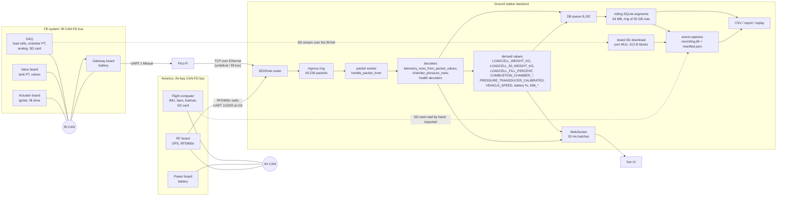
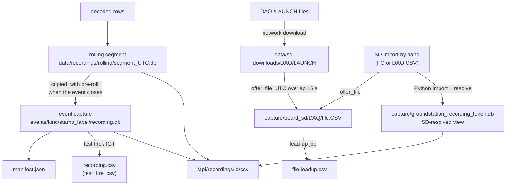
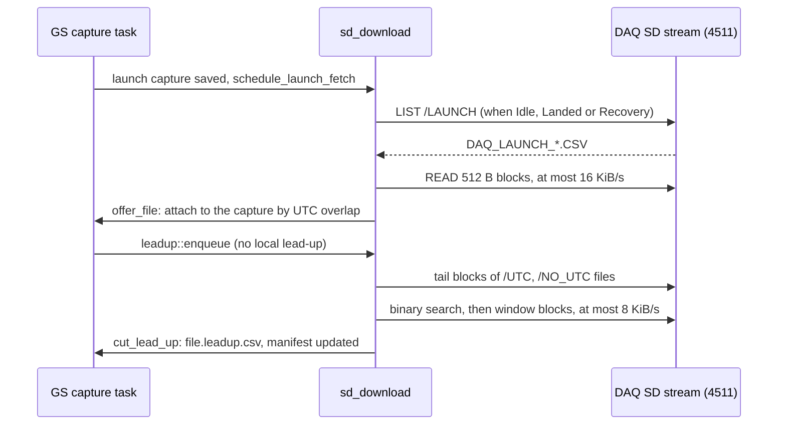

# Ground station data pipeline

This document traces data from every board to the ground station (GS), through
decoding and derived values, to the live UI and to everything the GS keeps on
disk. Each rate, buffer, path and data type is cited to the code that sets it.

Code references are to `backend/src/` unless another path is given. Board
references are to the sibling firmware repositories, read at `origin/dev`:

| Repo | Commit |
| --- | --- |
| DAQ-Board | `6f29611` |
| FlightComputer26 | `659440e` |
| ValveBoard26 | `b641993` |
| ActuatorBoard26 | `25e19bb` |
| gateway-board26 | `87f824e` |
| RFBoard26 | `a2fc87f` |
| PowerBoard26 | `22250a7` |

Related pages:

- [backend/rolling-recording.md](backend/rolling-recording.md): the store and its API.
- [backend/data-capture.md](backend/data-capture.md): exports.
- [backend/sd-network-download.md](backend/sd-network-download.md): board SD download.
- [backend/daq-launch-logging.md](backend/daq-launch-logging.md): `DAQ_LOG_CLOCK`.
- [integrated-ground-test.md](integrated-ground-test.md): the integrated ground test (IGT).

## 1. Overview

**Links.** `backend/comms/comms.json` sets up two links:

- `av_bay`: serial `/dev/ttyAMA0` at 115200 baud, `raw_uart`, to the RFD900x radio.
- `fill_box`: `pico_fi_tcp`, which reaches the gateway's Pico-Fi over Ethernet.

On the fill side:

- The gateway bridges its CAN side to Pico-Fi over a 1,000,000-baud UART (gateway-board26 `CMakeLists.txt:77`).
- Under receive pressure, the gateway ring drops best-effort KG1000, KG50 and FUEL_TANK_PRESSURE frames first (gateway-board26 `Core/Inc/can_rx_admission.h`).

On the avionics side, the RF board has two router sides, `can` and `radio` (RFBoard26 `Core/Src/telemetry.c`).

The DAQ, VB, AB and gateway never use the radio. The FC, PB and RF never use the fill link.

## 2. What the GS receives

### 2.1 Ingest path (all boards)

| Stage | Size / period | Behaviour when full | Source |
| --- | --- | --- | --- |
| Router to ingress ring | 65,536 packets (`GS_RING_BUFFER_CAPACITY`, 1,024 to 1,000,000) | drops the oldest packet, no counter | `main.rs:1536`, `ring_buffer.rs` `RingBuffer::push` |
| Ring to packet work queue | 256 packets per 1 ms tick (`GS_PACKET_ENQUEUE_BURST`); queue 8,192 (`GS_PACKET_WORK_QUEUE_SIZE`) | stops moving packets; logs "Telemetry ingest backpressured" | `telemetry_task.rs:49-50`, `:1026`, `:1820` |
| Packet worker to DB queue | 8,192 items (`GS_DB_WORK_QUEUE_SIZE`) | telemetry rows wait (`send().await`); health rows are dropped (`try_send`) | `main.rs:1499`, `telemetry_task.rs` `queue_db_write`, `telemetry_task/recording_diagnostics.rs` `raw_health` |
| DB batch | up to 256 rows or 8 ms (`GS_DB_BATCH_MAX`, `GS_DB_BATCH_WAIT_MS`) | n/a | `telemetry_task.rs:52-53`, `telemetry_task/recording_owner.rs` |
| Live cache | 20 min or 250,000 rows | drops the oldest rows | `state.rs` `cache_recent_telemetry` |
| WebSocket per client | flush every 20 ms (`GS_WS_TELEMETRY_FLUSH_MS`); at most 256 rows per flush (adaptive, starting at 192, minimum 64); pending cap 16,384 | drops the oldest rows | `web.rs:5553-5577`, `:5995-6038` |

Every recorded row has two timestamps:

- `timestamp_ms`: the GS clock when the packet worker processed the packet (`get_current_timestamp_ms()`, `telemetry_task.rs:3130`).
- `source_timestamp_ms`: the board's packet timestamp.

Captures, CSV export and report windows all use `timestamp_ms` (Section 5).

### 2.2 DAQ (fill CAN, then gateway, then Pico-Fi)

The DAQ caps sensor packets at `DAQ_NETWORK_RATE_HZ 100`
(DAQ-Board `Core/Inc/daq_network_config.h`, `daq_network_schedule.h`):

- Every fast-pair bin (KG1000 + chamber PT, 20 ms, 50/s) and every KG50 bin
  (50 ms, 20/s) gets a slot, dated at the bin centre.
- Temperature, SDADC, SAR, current and power share the remaining ≥ 30 slots/s
  by weight 1/2/1/1/2; each keeps only its latest value.

The DAQ converts KG1000 and the chamber PT at 1 kHz and KG50 at 800–900/s; the
packets carry the mean of each bin of a 3- (fast) or 5-sample (KG50) running
median. Every conversion is on the DAQ SD (DAQ-Board `docs/data-pipeline.md`).
Health types bypass the cap.

| SEDSnet type | Payload | Rate at GS | GS decoder | Rows recorded and shown | Units |
| --- | --- | --- | --- | --- | --- |
| `KG1000` | f32[1]: 20 ms bin of the 3-sample median of the 1000 kg cell | 50/s, shared with `DAQ_LOADCELL_CHAMBER` | generic f32 path (`telemetry_task/derived.rs` `telemetry_rows_from_packet_values`) | `KG1000`; derived `LOADCELL_WEIGHT_KG`; `LOADCELL_FILL_PERCENT` when the fill source is KG1000 | ADC-pin V; kg; % |
| `DAQ_LOADCELL_CHAMBER` | f32[3]: [KG1000, chamber psig, chamber connector V], both 20 ms bins of the same centre. Sent in the KG1000 slot when the chamber bin matches | 50/s, shared | `telemetry_task/derived.rs` `chamber_pressure_rows` | raw `DAQ_LOADCELL_CHAMBER`, `KG1000`, `COMBUSTION_CHAMBER_PRESSURE`, `COMBUSTION_CHAMBER_VOLTAGE`, `COMBUSTION_CHAMBER_RANGE_STATUS`, `COMBUSTION_CHAMBER_PT_INSTALLED`, plus the KG1000 derived rows | V; psig; V; 0/1 |
| `KG50` | f32[1]: AMP2 (CH1), 50 ms bin of the 5-sample median | 20/s, shared with `DAQ_KG50_SELECTED` | `loadcell::selected_kg50_value` | `KG50`; derived `LOADCELL_50_WEIGHT_KG`; `LOADCELL_FILL_PERCENT` (default fill source) | V; kg; % |
| `DAQ_KG50_SELECTED` | f32[2]: [source, value]; source 1 = P6 differential | 20/s, shared. Sent instead of `KG50` when the DAQ input is not AMP2 (`Core/Src/daq_thread.c` `daq_offer_live_report`) | `loadcell::selected_kg50_value` | recorded as `KG50` (8-byte payload); same derived rows | V |
| `DAQ_ADC_TEMPERATURE` | f32[1] | ≈ 4/s (interleave weight 1) | generic | `DAQ_ADC_TEMPERATURE`; also read by `loadcell::recent_adc_temperature` (2 s freshness) | °C |
| `DAQ_SDADC_VOLTAGES` | f32[6]: CH2, CH3, CH4, CH5, HVAIN1, HVAIN2 (latest 3-sample medians; HVAIN1 = chamber 20 ms bin) | ≈ 8/s (weight 2) | generic; DAC check `daq_dac::observe_values` | as received | connector V (HVAIN includes the 11x divider) |
| `DAQ_SAR_VOLTAGES` | f32[8]: SAR_IN1..8 | ≈ 4/s (weight 1) | generic; `daq_dac::observe_values` | as received | V |
| `DAQ_CURRENT_SENSE` | f32[4]: J7 V, J8 V, J7 A, J8 A | ≈ 4/s (weight 1) | generic | as received | V, A |
| `DAQ_POWER_MONITOR` | f32[4]: VMON V, IMON V, VMAIN V, input A | ≈ 8/s (weight 2) | generic | as received | V, A |
| `DAQ_INPUT_HEALTH` | u32[18], version 2 (layout in `daq_input_health.rs` header; version 1 u32[10] still decodes): faults plus per-channel noise/drift, excitation mV, ADC frame counters | 1/s, at most every 200 ms (`DAQ_INPUT_HEALTH_PERIOD_MS`, `Core/Inc/daq_input_fault_config.h:131`) | `network_health::observe_input_health`, `daq_input_health::observe_alerts` | raw payload row, `values_json` `[]`; alerts | mV fields |
| `DAQ_SD_HEALTH` | u32[8] | every 5 s | `network_health::observe_sd_status` | raw payload row | |
| `DAQ_LAUNCH_LOG_STATUS` | u32[7] | every 5 s | `network_health::observe_launch_log_status` | raw payload row; `/api/network_topology` `launch_log` | |
| `DAQ_DAC_STATUS` | u8[80] | while the DAC runs | `network_health::observe_dac_status`, `daq_dac::observe_status` | raw payload row | |
| `BOARD_HEALTH` | u32[24] | every 5 s (all boards) | `network_health::observe_diagnostics_with_source`; DAQ `board_config_sync::observe_daq_health` | raw payload row | |

Any `KG1000`/`KG50` sample from the DAQ also feeds the tare and auto-zero
tracker. The sample must be fresh: its source age must be between -100 and
2,000 ms when both clocks are UTC (`telemetry_task.rs`, after `:3243`).

The GS sends these to the DAQ (endpoint `SD_CARD`), all from `network_variables.rs`:

- `DAQ_LOADCELL_CALIBRATION`, `DAQ_KG50_CALIBRATION` (`loadcell::kg50_daq_coefficients`), `DAQ_THERMAL_CALIBRATION`, `DAQ_FILTER_CALIBRATION`.
- `DAQ_KG50_INPUT`.
- `DAQ_LOG_CLOCK`.
- `DAQ_SD_RETRY`.

#### Load-cell conversion (`telemetry_task/derived.rs` `prepare_derived_loadcell_rows`)

The steps run in this order:

1. **Rail check.** `loadcell::loadcell_volts_at_rail` withholds the weight (`None`) when the input is clipped. The limits are:
   - KG1000: at or below 0.0434 V, or at or above 2.4 V.
   - AMP2 KG50: ±2.4 V.
   - P6 KG50: ±0.15 V.

   The first sample of a clipped episode raises an alert, then nothing for a 30 s holdoff (`LOADCELL_RAIL_ALERT_HOLDOFF_MS`).
2. **Thermal offset.** `loadcell::temperature_corrected_raw` subtracts `raw_per_c × (T − reference)`. It applies only when a thermal entry exists with a nonzero slope. The shipped `backend/calibration/loadcell_calibration.json` has no `thermal` entry.
3. **Low-pass filter.** `loadcell_zero::Service::filter` applies a first-order low-pass, `alpha = dt / (tau + dt)`, with `tau` from `noise.<sensor>.tau_ms` (0 to 2,000 ms). It uses DAQ samples only, and resets when the gap exceeds 2 s.
4. **Fit.** `loadcell::calibrated_sensor_value` evaluates a linear fit or a poly2/3/4 fit in `x − x0`, minus the fit's value at the zero point. Channels: `ch1` (KG1000), `kg50`, `iadc` (tank PT).
5. **Fill mass and percent.** Mass is the calibrated kg of the fill source: `fill_targets::FillSource`, default `Kg50`; `Kg1000Absolute` uses `|kg|`. `loadcell::fill_percent` gives `clamp(100 × mass / target, 0, 100)`. The target is `nitrogen.target_mass_kg` in PreFill, FillTest and NitrogenFill, and `nitrous.target_mass_kg` otherwise (`loadcell::active_fill_target_mass_kg`; defaults 0.5 kg and 8.0 kg in `backend/config/fill_targets.json`). KG50 drives no mass until a `kg50` calibration exists.
6. **Calibration snapshot.** A `calibration_history` row (`DbWrite::Calibration`) is written per sender and sensor when the configuration changes, and otherwise every 10 s (`emit_derived_loadcell_rows`).

#### Chamber PT (`chamber_pressure_rows`)

- The DAQ computes psig (connector V × 200, PX309-1KG5V). The GS only forwards it, after these checks:
  - |psig| ≤ 5,280 and |V| ≤ 26.4 are required.
  - `RANGE_STATUS` = 1 outside 0 to 1,000 psig or 0 to 5 V.
- With `chamber_pt_installed = false`, pressure and status are recorded as `null` and `PT_INSTALLED` as 0. The raw vector is still recorded.

### 2.3 Valve board (fill CAN)

| Type | Payload | Rate (VB source) | GS handling | Derived | Units |
| --- | --- | --- | --- | --- | --- |
| `FUEL_TANK_PRESSURE` | f32[1] | 50 Hz, latest of a 500 Hz ADC (`VALVE_PRESSURE_REPORT_HZ 50`, `Core/Inc/telemetry_rates.h:6`) | generic; `gse::observe_valve_pressure_ingress`; `gse::overpressure::evaluate` | `PRESSURE_TRANSDUCER_CALIBRATED` through the `iadc` calibration | psi |
| `VALVE_PRESSURE_SD_V1` | u8[44] | about 62.5 batches/s, to the DAQ only | not received by the GS; logged on the DAQ SD as `valve_pressure_psi` | | |
| `UMBILICAL_STATUS` | u8[2] | every 500 ms plus on change (`UMBILICAL_STATUS_PERIOD_TICKS`, `Core/Src/main_thread.c:30`) | `validate_umbilical_status`, `persist_umbilical_status` | valve state | |
| `BATTERY_VOLTAGE` / `BATTERY_CURRENT` | f32[1] | 1 s | generic; `emit_derived_battery_rows` | battery %, drop rate, remaining time | V, A |
| `WARNING` | string | event | `gse::auto_vent::board_warning`, `gse::overpressure::board_warning` | | |

### 2.4 Actuator board (fill CAN)

| Type | Payload | Rate | GS handling |
| --- | --- | --- | --- |
| `UMBILICAL_STATUS` | u8[2] | 500 ms plus on change (`Core/Src/main_task.c:47`) | as for VB |
| `AB_IGNITER_SENSE` | u32[12] | at most 5 Hz | `igniter_sense` tracker; rows `IGNITER_SENSE_STATUS` and `IGNITER_SENSE_SIGNAL` (counts, V, A) |
| `AB_FILL_DRIVE_STATUS`, `AB_FILL_MOTION_STATUS_V2` | u8[40], u8[56] | on query | `actuator_plumbing` |

### 2.5 Gateway board

`BATTERY_VOLTAGE` and `BATTERY_CURRENT` every 1 s (`DATA_ACQ_REPORT_PERIOD_TICKS`, `Core/Src/data_acq.c:17`).

The GS treats the gateway's battery as the fill-system battery
(`is_fill_system_battery_sender`): it warns at ≤13 V and re-arms the warning
above 15 V (`telemetry_task/derived.rs:4-5`).

### 2.6 Flight computer (AV CAN, then RF board, then radio)

`FC_TELEMETRY_RATE_HZ 5` (FlightComputer26 `Core/Inc/telemetry_rate.h:10`).

| Type | Payload | Rate | GS handling | Derived |
| --- | --- | --- | --- | --- |
| `IMU_DATA` | f32[6] | 5 Hz | split by `split_imu_values` into `ACCEL_DATA` and `GYRO_DATA` | `VEHICLE_SPEED` |
| `BAROMETER_DATA` | f32[3] (alt, prs, tmp) | 5 Hz | generic; `fc_estimator::observe_barometer` | `VEHICLE_SPEED`; baro reference in the estimator view |
| `ASCENT_STATE` / `DESCENT_STATE` | f32[6] / f32[4] | 5 Hz while the filter runs | generic | trajectory |
| `GPS_DATA` | f32[3] | event | `normalized_gps_values` | |
| `FLIGHT_STATE` | u8[1] | every 2,000 ms in flight plus on change (`FC_STATE_REPUBLISH_MS`, `Core/Src/telemetry.c:1481`) | flight-state authority; `flight_state` table | starts and ends the launch capture |
| `BOARD_HEALTH` | u32[24] | every 5 s | `fc_estimator::observe_health` (estimator phase, cycles, baro reference); `igt::observe_health`; `launch_site::observe_fc_health`; `fc_command_gate::observe` | estimator view (`FcEstimator` WebSocket message) |
| `SIM_SAMPLE` | f32[8] | during an IGT replay | recorded raw; `igt::sim_rows` | `SIM_IMU_DATA`, `SIM_BAROMETER_DATA`, `SIM_GPS_DATA`, `SIM_ASCENT_STATE`, `SIM_DESCENT_STATE` (`igt::sim_series`) |
| `MESSAGE_DATA` / `ORDERED_MESSAGE` | string | event | `recovery_events`, `flight_maxima` | messages table |
| `LAUNCH_SITE` | f32[3] | echo | `launch_site::observe_echo` | |

### 2.7 RF board and power board

- **RF:** `GPS_DATA`, `GPS_SATELLITE_NUMBER` and `GPS_STATUS`, each at 1 Hz (`RF_TELEMETRY_RATE_HZ 1`, RFBoard26 `Core/Inc/telemetry_rate.h:9`). `GPS_SATELLITE_NUMBER` goes through `handle_gps_satellite_count_packet`.
- **PB:** `BATTERY_VOLTAGE` and `BATTERY_CURRENT` at 1 Hz (`PB_TELEMETRY_RATE_HZ 1.0`).

### 2.8 UI layouts keyed on DAQ types

`backend/layout/layout.json`, `layout_hitl.json` and `layout_test_fire.json` hold the same DAQ views:

- **Data, Loadcell:**
  - 1000kg: `KG1000`, `LOADCELL_WEIGHT_KG`, `LOADCELL_FILL_PERCENT`, `DAQ_ADC_TEMPERATURE`.
  - 50kg: `KG50`, `LOADCELL_50_WEIGHT_KG`, `DAQ_ADC_TEMPERATURE`.
  - Chamber pressure: `COMBUSTION_CHAMBER_*`.
- **Data, DAQ analog:** SAR inputs (8), SDADC inputs (6), Current sensors (4), Power monitor (4), and the two load-cell subtabs.
- **State tab, Fill Metrics:** `LOADCELL_WEIGHT_KG` and `LOADCELL_FILL_PERCENT`.

## 3. Recording paths

### 3.1 Rolling segments (`recording_store.rs`, `telemetry_task/rolling.rs`)

**Format.** SQLite (`telemetry_db.rs` `ensure_telemetry_schema`):

- `telemetry(id, timestamp_ms, source_timestamp_ms, data_type, sender_id, values_json, payload_json)`
- Also `alerts`, `flight_state` and `messages` tables.
- A `loadcell_units` table marks the first row whose load-cell values are ADC-pin volts. Rows before it are on the DAQ legacy raw scale (`telemetry_db::mark_loadcell_volts`, `loadcell_volts_from_id`).

**Path.** `data/recordings/rolling/segment_<UTC stamp>.db` (`STORE_DIR`, `ROLLING_DIR`, `SEGMENT_PREFIX`).

**Length.** By size, not by time:

- A segment rotates once it reaches `segment_mb` (default 64).
- The size is checked every 2 s (`MAINTENANCE_INTERVAL`, `Rolling::maintain`).
- Every new segment starts with the station-mode/IGT rows and the latest calibration of every sensor (`Rolling::open_segment`).

**Retention.** The ring budget is `min(ring_budget_mb, ring bytes + free − reserve_free_mb)` (`effective_budget`). Defaults:

| Setting | Default |
| --- | --- |
| `ring_budget_mb` | 50 × 1,024 |
| `reserve_free_mb` | 8,192 |
| `warn_free_mb` | 2,048 |
| `critical_free_mb` | 512 |

- When over budget, the oldest closed segments are deleted first. The active segment and any segment pinned by a pending capture are never deleted (`maintain_ring`).
- A low-disk warning repeats at most every 600 s (`DISK_WARNING_INTERVAL`).

Every decoded and derived row is recorded: `should_persist_telemetry_sample` always returns true (`telemetry_task/derived.rs:47`).

### 3.2 Event captures

**Trigger.** A capture opens when its trigger fires:

- Launch, HITL and abort: `recording_store::observe_flight_state`.
- Each sequence run: `EventKind::from_sequence`.
- IGT, DAC sweeps and manual saves.

**Saving.** At `event end + post-roll`, plus 2 s (`FLUSH_GRACE_MS`), `capture_task` (1 s tick) copies the window out of the ring by `ATTACH`ing each segment. Files written:

- `events/<kind>/<stamp>_<label>/recording.db`
- `manifest.json`

Defaults come from `EventKind::default_policy` (`recording_store.rs:127-149`):

| Kind | Starts | Ends | Pre-roll | Post-roll | Max |
| --- | --- | --- | --- | --- | --- |
| `launch` | FLIGHT_STATE in Launch, Ascent, Coast, Apogee, Descent, Reefing or InFlight | Landed, Recovery, Aborted, Idle or Startup | 600 s | 300 s | 2 h |
| `hitl` | same, in HITL mode | same | 300 s | 120 s | 2 h |
| `abort` | FLIGHT_STATE Aborted | leaving Aborted | 300 s | 300 s | 1 h |
| `fill` | sequence accepted | terminal result | 120 s | 120 s | 6 h |
| `nitrogen_test`, `turbocharge` | same | same | 120 s | 120 s | 2 h |
| `cold_flow` | same | same | 120 s | 180 s | 2 h |
| `valve_self_test` | same | same | 60 s | 60 s | 1 h |
| `igniter` | same | same | 120 s | 120 s | 1 h |
| `ground_test` | IGT active | IGT exited | 120 s | 120 s | 8 h |
| `daq_dac` | DAC sweep start | sweep result | 30 s | 30 s | 2 h |
| `manual` | `POST /api/recordings/snapshot` | immediately | chosen (120 s) | 0 | 1 h |

- An administrator can change every value. Limits: pre/post ≤ 4 h; max 60 s to 24 h (`recording_store.rs:218-220`).
- Captures are never deleted automatically.
- In test fire and IGT modes each capture also gets the GSE CSV `recording.csv`, written by `test_fire_csv::export_recording_csv` (`recording_store::run_due`).

### 3.3 Board SD attachments (`recording_store/board_sd.rs`)

**Classification.** `classify_name`:

- File names starting `irec` belong to the FC; names starting `DAQ` belong to the DAQ.
- `_LAUNCH` marks a launch file.
- Only `.CSV` files are considered.

**Parsing.** `row_fields` reads field 0 `timestamp_ms`, field 1 `monotonic_ms` and field 7 `time_source`. Only rows with `time_source = network` date a file. Lines starting `#` or `timestamp_ms` are skipped.

**Matching.** `matching_capture` picks the `launch`, `hitl` or `ground_test` capture whose window ±5 s (`MATCH_SLACK_MS`) best overlaps the file's network-UTC span. Launch and HITL rank above ground test.

**Storage.** `offer_file` copies the file unchanged to `<capture>/board_sd/<BOARD>/<name>`. It adds a `board_sd` manifest entry (bytes, SHA-256, first/last UTC, rows, `matched_by: utc_window`, source) and deduplicates by SHA-256.

**Sources.**

- **DAQ by network.** `sd_download::fetch_launch_files`, after a `launch` capture is saved:
  - Waits until downloads are allowed (Idle, Landed or Recovery, no sequence, no other transfer), giving up after 1 h.
  - Lists `/LAUNCH` over SEDSnet port 4511 (`SD_FILE_STREAM_PORT`).
  - Downloads in 512-byte blocks (`BLOCK_BYTES`) at most 16 KiB/s (`GS_SD_DOWNLOAD_MAX_BYTES_PER_SEC`), to `data/sd-downloads/DAQ/LAUNCH/`.
  - A finished file is offered, and `rescan_downloads` re-offers earlier downloads when a capture is saved.
- **Any board by import.** `recording_sd::upload` offers an imported CSV to `offer_file`. The FC does not serve its card over the network.

### 3.4 DAQ lead-up fetch (`sd_download/leadup.rs`)

**Why.** The DAQ starts its launch file at Launch acceptance; the countdown before that stays in its regular session file. The GS keeps the 60 s before the launch file's first network row (`LEAD_UP_MS`) as `<name>.leadup.csv`. The window is `[first − 60 s, first)` (`cut_lead_up`).

**From local files.** If a regular DAQ file already downloaded to `sd-downloads/DAQ/{UTC,NO_UTC}` ends within 5 s after the launch file starts, the lead-up is cut from it (`fill_lead_ups`).

**From the card.** Otherwise a job is queued in `data/sd-downloads/DAQ/leadup/jobs.json`. The job (`leadup::step`):

1. Reads the last two 512 B blocks of each non-LAUNCH file.
2. Picks the file whose last network row lies in `[from, to + 5 s]`.
3. Downloads the file whole if it is 16 MiB or smaller (`SMALL_FILE_BYTES`).
4. Otherwise binary-searches single blocks for the window start, starting 2 s early (`SEARCH_MARGIN_MS`), and reads forward (`fetch_window`).

**Limits.**

- Runs only in the download states.
- Pauses for any other transfer and for 10 s after any command transmission (`QUIET_AFTER_COMMAND`).
- Rate: `GS_SD_LEADUP_MAX_BYTES_PER_SEC`, default 8 KiB/s.
- Offsets are saved, so a job resumes after a link drop or a restart.

### 3.5 SD import into a recording (`recording_sd.rs`, `recording_sd_import.py`, `recording_sd_resolve.py`)

**Routes.** `POST /api/recordings/{id}/sd/imports` stages a manifest; `PUT …/{token}` uploads the CSV. Segments are refused: import into a capture or a legacy file.

**Worker.** A Python process (`GS_REPORT_PYTHON`, default `python3`) does the work:

- `create_derived_recording` copies the recording.
- `import_csv` requires the exact 13-column header (`FIELDS`):

  `timestamp_ms,monotonic_ms,sensor,value,raw_adc_code,raw_value,calibrated_value,time_source,adc_temperature_c,adc_temperature_code,uptime_ticks,uptime_frequency_hz,record_sequence`

  It stores rows in `sd_samples` and the original bytes in `sd_source_chunks`.
- `resolve_recording` builds `sd_replay_telemetry`. SD rows replace network rows of the same sender and type wherever the SD gives continuous coverage (gap ≤ `max_gap_ms`).

**DAQ mapping profile `daq-20261123`** (firmware head `DAQ_SD_HEAD_US` = DAQ-Board `e5fad32`, the 1 kHz frame schedule). MCP3564R rows carry microsecond `uptime_ticks` (`uptime_frequency_hz` 1000000):

| Mapping | SD sensor(s) | GS type |
| --- | --- | --- |
| `kg1000_v` | `kg1000_v` | `KG1000` (rebuilt with `MedianBin`: 3-sample median, 20000 µs bins, dated at the bin centre; bit-identical to the DAQ's packets) |
| `kg50_v` | `kg50_v`, `kg50_p6_v` | `KG50` (5-sample median, 50000 µs bins; restarts on an input switch) |
| `kg1000_kg`, `kg50_kg` | `calibrated_value` | `LOADCELL_WEIGHT_KG`, `LOADCELL_50_WEIGHT_KG` (every conversion) |
| `input_supply` | `input_voltage_v` + `input_current_a` | `DAQ_POWER_MONITOR` |

**DAQ mapping profile `daq-20261117`.** It accepts firmware heads `44a9195` and `55fe7a8` only:

| Mapping | SD sensor(s) | GS type |
| --- | --- | --- |
| `kg1000_v` | `kg1000_v` | `KG1000` (rebuilt with `Boxcar`, 4 ms or the file's `loadcell_boxcar_ms`) |
| `kg50_v` | `kg50_v`, `kg50_p6_v` | `KG50` (same boxcar) |
| `kg1000_kg` | `kg1000_v` (`calibrated_value`) | `LOADCELL_WEIGHT_KG` |
| `kg50_kg` | `kg50_v` (`calibrated_value`) | `LOADCELL_50_WEIGHT_KG` |
| `input_supply` | `input_voltage_v` + `input_current_a` | `DAQ_POWER_MONITOR` |

The older `daq-20261101` profile maps `kg50_raw`, `mcp3564r_raw`, `kg50_network` and `kg1000_network`.

The result is published as `groundstation_recording_<token>.db` beside the source recording, or in the capture folder as an attachment.

### 3.6 Burn report (not on `dev`)

`dev` has no burn report and no impulse computation. The design is in
`docs/apogee-planner.md` §7–8 on branch `burn-report` (commit `e05bb92`). It
has these steps:

1. When a launch, ground-test or HITL capture closes, compute a provisional report from GS rows (`LOADCELL_WEIGHT_KG`, `LOADCELL_50_WEIGHT_KG`, tank PT, chamber PT).
2. Fetch the DAQ `/LAUNCH` file ahead of the lead-up job.
3. Recompute a final report from both sources aligned on network time. DAQ SD rows are preferred for the load cells and the chamber; gaps are filled from the other source, keeping provenance.
4. Compute thrust as `g · (F(t) + (R_pre − R(t)) − burned(t))`, where F is KG1000 and R is KG50.
5. Integrate total impulse over the curve. Also derive burn time (5 % of peak), peak and average thrust, Isp and quality flags.
6. Write `burn_report.json` and `burn_thrust.csv` into the capture folder.

The expected DAQ input is the 13-column SD CSV with `time_source = network` rows.
With the DAQ's 1 kHz frame schedule (DAQ-Board `docs/data-pipeline.md`) the
reader must:

- take `kg1000_v`, `kg50_v`/`kg50_p6_v` and `chamber_pressure_v`;
- integrate on `uptime_ticks / uptime_frequency_hz`. That is microseconds for
  these rows: KG1000 and the chamber PT are exactly 1000 µs apart.
  `timestamp_ms` keeps 1 ms resolution and serves only for network-time
  alignment.

The work-in-progress merge outside dev reads the removed `kg1000_network`,
`kg50_network` and `chamber_pressure_raw_volts_psi` names, and millisecond
times.

### 3.7 CSV export (`recording_export.rs`)

`GET /api/recordings/{id}/csv` (ViewData permission). Any recording id is accepted:

- `rolling.segment_<stamp>.db`
- `event.<kind>.<folder>.db`
- attachments
- legacy files

It streams 512-row pages (`PAGE_SIZE`) up to the `MAX(id)` read when the request starts, so the export is a finite snapshot.

**Columns.** `id,received_timestamp_ms,source_timestamp_ms,sender_id,data_type,values_json,payload_json` (`HEADER`), with these variants:

- An SD-resolved recording adds `canonical_utc_ms,provenance_json` (`RESOLVED_HEADER`).
- An IGT recording adds `data_provenance` (`simulated`, `ground_station` or `real`, from `Provenance::classify`).

**Content.** Values are exported as recorded: no decimation, no recalibration, no unit conversion.

`GET /api/recordings/csv?start_ms&end_ms` searches the ring and the legacy files by receive time (`recording_range.rs`).

### 3.8 Replays

**Recorded-vehicle replay** (`recording_replay.rs`). Read-only windows from a recording:

- Windows of at most 30 s (`MAX_WINDOW_MS`), in 512-row pages.
- Legacy-scale load-cell rows are converted to volts (`loadcell::legacy_loadcell_row_to_volts`).

**IGT replay.** The FC replays `/IGT/IMU0.CSV`, `BARO0.CSV` and `GPS0.CSV` from its own SD card into its estimator.

- The GS does not send the replay data. It receives the replayed values and the estimator outputs only as `SIM_SAMPLE`, records them raw, and shows them as separate `SIM_*` series (`igt::sim_rows`).
- In IGT mode, CSV exports label every row `simulated`, `ground_station` or `real`.

## 4. Board SD vs GS, per stream

The two rate columns cover different things:

- **Board SD:** the board-side rate. It is not visible to the GS until the card is fetched or imported.
- **GS:** what reaches the GS and is recorded in the rolling segment.

| Stream | On the board SD | Reaches the GS and is recorded |
| --- | --- | --- |
| KG1000 cell | `kg1000_v`: every MCP3564R conversion, exactly 1000/s, µs `uptime_ticks`, ADC code + pin V + on-board kg; `kg1000_window_*` every 100 ms | `KG1000` or `DAQ_LOADCELL_CHAMBER` at 50/s, each a 20 ms bin of a 3-sample median (f32 V); plus GS `LOADCELL_WEIGHT_KG` at the same rate |
| KG50 cell | `kg50_v` (AMP2) or `kg50_p6_v` (P6) per conversion, 800/s (900/s in the launch window), µs `uptime_ticks`; `kg50_window_v` every 100 ms | `KG50` at 20/s (50 ms bin of a 5-sample median, V); `LOADCELL_50_WEIGHT_KG` and `LOADCELL_FILL_PERCENT` |
| Chamber PT | `chamber_pressure_v` per conversion, exactly 1000/s (connector V, psig) | inside `DAQ_LOADCELL_CHAMBER` at 50/s; `COMBUSTION_CHAMBER_*` rows |
| DAQ supply | `input_voltage_v`, `input_current_a`: every 100 ms, every 4 ms from 0.5 s before the launch window to its end (`DAQ_SUPPLY_LAUNCH_PERIOD_MS`) | `DAQ_POWER_MONITOR` at about 8/s |
| SAR / current / aux analog | `analog_in_1..8_v`, `isense*`, `vmon_v`, `imon_v`, `analog_out_*`: every 100 ms | `DAQ_SAR_VOLTAGES`, `DAQ_CURRENT_SENSE`, `DAQ_POWER_MONITOR` at 4/s each |
| MCP CH2–7 | `mcp3564r_ch2_v`..`ch7_v`: aux pass every 100 ms | `DAQ_SDADC_VOLTAGES` at 4/s |
| ADC die temperature | `adc_temperature_c` on every raw row; `mcp3564r_temp_c` every 100 ms | `DAQ_ADC_TEMPERATURE` at 4/s |
| VB tank PT | `valve_pressure_psi` on the DAQ SD: 250 Hz, VB 12-bit code + psi | `FUEL_TANK_PRESSURE` at 50 Hz from the VB, then `PRESSURE_TRANSDUCER_CALIBRATED` |
| FC IMU | `gyroscope_sample`, `accelerometer_sample` per acquisition (100 Hz ODR); `IMU` summary every 50 ms (`LOG_RATE_SD`) | `IMU_DATA` at 5 Hz, then `ACCEL_DATA` and `GYRO_DATA` |
| FC baro | `barometer_sample` (25 Hz ODR); `BARO` every 50 ms | `BAROMETER_DATA` at 5 Hz |
| FC Kalman | `EKF` / `DKF` per filter output | `ASCENT_STATE` / `DESCENT_STATE` at 5 Hz |
| GPS | none (RF has no SD) | `GPS_DATA` 1 Hz (RF) |
| VB/AB valves, igniter sense, batteries | none (no SD on VB, AB, GW, RF or PB) | as received (§2.3–2.7) |

Sources: DAQ-Board `docs/sd-record-format.md` and `Core/Inc/daq_rates.h`; FlightComputer26 `Core/Inc/fcconfig.h:30` and `Core/Inc/telemetry_rate.h:10`.

DAQ SD files:

- Regular sessions: `/UTC/DAQ_<stamp>_<NNN>.CSV` or `/NO_UTC/…`.
- Launch window: `/LAUNCH/DAQ_LAUNCH_<stamp>_<NNN>.CSV`, `SD_LAUNCH_WINDOW_MS 20000` (`Core/Src/sd_card.c:329`).
- Each file starts with the header and a `# calibration,…,loadcell_input=adc_volts,…` line: `loadcell_report=median_bin,kg1000_median=3,kg1000_bin_us=20000,kg50_median=5,kg50_bin_us=50000,adc_uptime_hz=1000000` (older files: `loadcell_boxcar_ms=N`).

FC files are `irec-…csv` and `irec_LAUNCH-…csv` at the card root (`Core/Src/sdpipeline.c`).

## 5. Latency and rates end to end

| Segment | Determinable value | Source |
| --- | --- | --- |
| DAQ conversion to load-cell value | 20 ms (fast pair) or 50 ms (KG50) bin of a running median, dated at the bin centre | DAQ `daq_rates.h` `DAQ_FAST_REPORT_US`, `DAQ_KG50_REPORT_US` |
| DAQ value to packet | load-cell bins: next 10 ms slot, every bin sent; auxiliary: up to a few hundred ms, latest value only | `daq_network_schedule.h` |
| Fill CAN to gateway to Pico-Fi | UART at 1 Mbaud; Pico-Fi queues 128 frames each way | gateway `CMakeLists.txt:77`; [picofi-ethernet.md](picofi-ethernet.md) |
| FC to radio | 5 Hz; radio UART 115200 baud | FlightComputer26 `telemetry_rate.h`; `comms.json` |
| GS ring to worker | 1 ms pump tick, 256 packets per tick | `telemetry_task.rs:1026` |
| Worker to SQLite | at most 256 rows or 8 ms per batch | `DB_BATCH_*` |
| Worker to browser | 20 ms flush | `GS_WS_TELEMETRY_FLUSH_MS` |
| Capture written | event end + post-roll + 2 s, on a 1 s tick | `FLUSH_GRACE_MS`, `capture_task` |
| DAQ launch file at GS | after the vehicle is safe; 16 KiB/s | `sd_download.rs` |

The latency from board to GS is not fixed. Each row records it as
`received_timestamp_ms − source_timestamp_ms` when the board is on network UTC.

**GS rows per second from the DAQ** (chamber PT installed, default KG50 fill source):

- KG1000 slot: 7 rows per packet × 50/s.
- KG50 slot: 3 rows per packet × 20/s.
- Five auxiliary types sharing about 30 packets/s.
- Total about 450 rows/s.

Each row repeats the packet's `payload_json`.

**External raw feed.** Every row published to the live UI (the `ws_tx`
fan-out, after the decoders and derived values above) is also available
read-only, with field names, units, the receipt/source/network times and
live/sim/replay provenance, on `GET /api/stream/raw/ws` and `GET /api/stream/raw`
(NDJSON). See [backend/raw-stream-feed.md](backend/raw-stream-feed.md). It
shares the WebSocket's rows, not the recording: rows dropped by §6 item 5 for
the UI are not dropped for the feed, which has its own per-client caps.

## 6. Known gaps / bugs found

These are described, not fixed.

1. **Ingress overflow loses packets silently.**
   - `RingBuffer::push` drops the oldest packet when the 65,536-entry ring is full, with no counter or alert (`ring_buffer.rs:30-35`).
   - Upstream of it, the DB queue makes the packet worker wait (`telemetry_task.rs` `queue_db_write`).
   - So a stalled SQLite writer becomes loss of the oldest packets, not a reported error.
2. **The receive timestamp is the processing time.** `timestamp_ms` is taken when the worker handles the packet (`telemetry_task.rs:3130`), not when it arrived. A backlog shifts `received_timestamp_ms` and the capture windows built on it. The load-cell filter `dt` (`loadcell_zero.rs` `Filter::add`) also comes from this time.
3. **KG50 packets for the unselected input are not recorded.** `telemetry_rows_from_packet_values` returns no rows for `KG50` or `DAQ_KG50_SELECTED` packets that do not match the station's `kg50_input`, and for those types from any sender other than `DAQ` (`telemetry_task/derived.rs:1264-1274`). The packet path records only the returned rows (`telemetry_task.rs:3243`), so these packets leave no trace in the recording, for example during an input switch. The same applies to a `DAQ_LOADCELL_CHAMBER` with ≠3 values or from another sender (`telemetry_task/derived.rs:1093`).
4. **Health rows are dropped under load.** `raw_health` uses `try_send`, so `BOARD_HEALTH`, `DAQ_SD_HEALTH`, `DAQ_INPUT_HEALTH` and `DAQ_LAUNCH_LOG_STATUS` rows are discarded when the DB queue is full (`telemetry_task/recording_diagnostics.rs:137`). There is only an internal counter.
5. **The live UI drops rows under load.** Each WebSocket flush keeps only the newest `dynamic_max_per_flush` rows (`web.rs:6006-6008`). At 20 ms that caps a client at 12,800 rows/s, and lower when congested.
6. **CSV export does not convert legacy units.** `csv_page` exports `values_json` as recorded (`recording_export.rs:280`). Rows before `loadcell_units.first_volts_id` are on the DAQ legacy raw scale and nothing in the CSV marks them. The replay (`recording_replay.rs:165`) and `test_fire_csv.rs:138` convert them; the CSV does not.
7. **The test-fire CSV uses the current calibration, and its Thrust column is in kg.**
   - The CSV is computed with the calibration loaded when the export runs, not the recording's `calibration_history` (`recording_store.rs:1048`, `telemetry_task.rs:2314`).
   - `Weight` is always `0.0` and `Thrust` repeats `1000kg Calibrated` in kg (`test_fire_csv.rs:115`, `:260`).
8. **The SD resolver rejects current DAQ firmware.** The resolver accepts only DAQ heads `44a9195` and `55fe7a8` (`recording_sd_resolve.py:12-16`, `:145`). DAQ `origin/dev` is `6f29611`, which changed `Core/Src/sd_card.c` after `44a9195`. A manifest with the current head is refused even though the 13-column format is unchanged. `kg50_kg` maps only `kg50_v`, so a P6 run has no SD weight (`recording_sd_resolve.py:49`).
9. **The DAQ launch-file fetch is fragile.** The request is an in-memory flag (`sd_download.rs:939-946`), lost on a restart. It is set only for `launch` captures, not `hitl` or `ground_test` (`recording_store.rs:1059`). It gives up after 1 h of unavailable downloads (`sd_download.rs:953`). The lead-up jobs, by contrast, persist.
10. **Thermal correction depends on a fresh temperature.** If a thermal entry with a nonzero slope is configured, `temperature_corrected_raw` returns `None` without a `DAQ_ADC_TEMPERATURE` from the last 2 s (`loadcell.rs` `recent_adc_temperature`, `temperature_corrected_raw`). The weight then becomes unavailable.
11. **Documentation mismatch.** [backend/rolling-recording.md](backend/rolling-recording.md) gives the HITL capture 10 min / 5 min. The code default is 300 s / 120 s (`recording_store.rs:131`).
12. **No burn report on `dev`.** No impulse, thrust or merge code exists on `dev` (§3.6). Until it lands, the merged DAQ SD data is reachable only through the SD import (§3.5) and the attached raw files.
