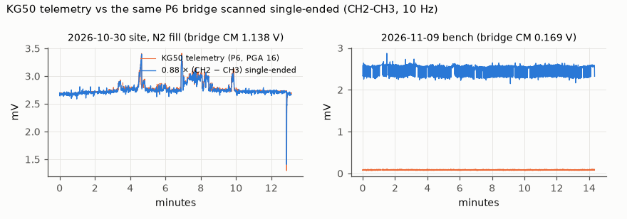
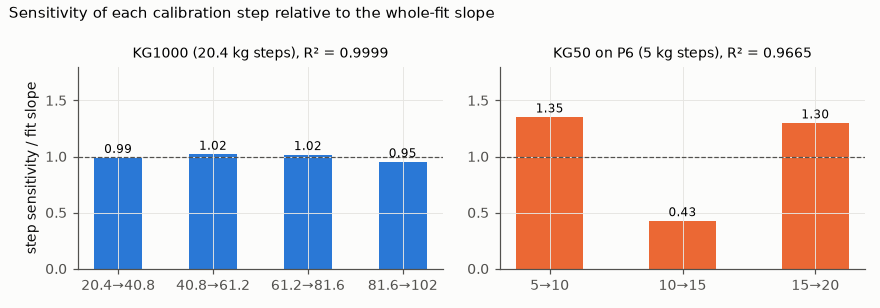
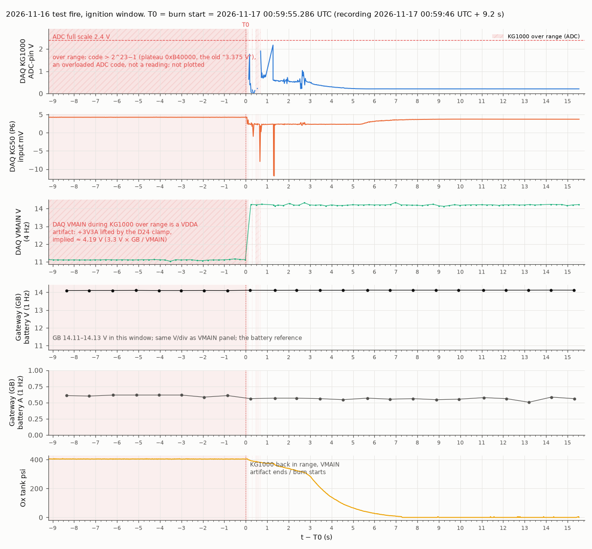
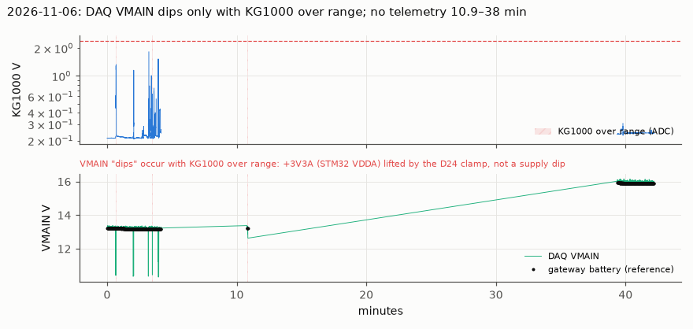
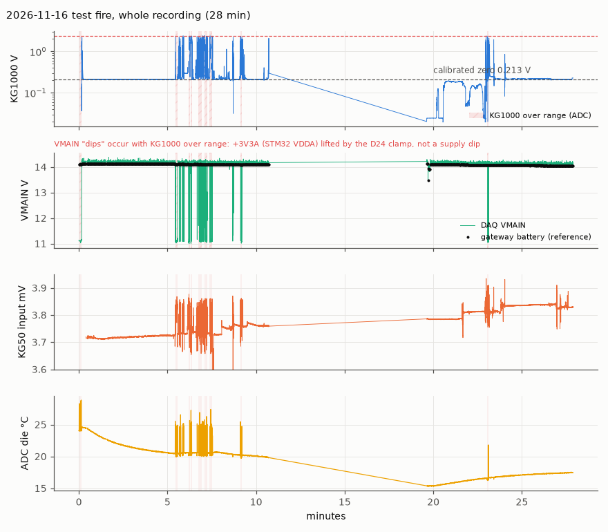

# Load-cell investigation, November 2026

The question was why KG1000 (thrust) and KG50 (fill mass) are never accurate at the
site and drift, while the firmware appears to work in the lab.

Every recording analysed here came from the **old pipeline**. The DAQ sent KG1000 on the
legacy raw scale (`code * 2.2104 / 2^27`) and KG50 as P6 input volts, and the GS applied
count-based calibrations. The volts conversion and the volts→kg calibration (2026-11-17)
have not been used in the field yet.

Figures and per-recording numbers are in
[`loadcell-investigation-2026-11/`](loadcell-investigation-2026-11/): `summary.csv` and
`summary.json`. The scripts are in `tools/loadcell_investigation/`:

- `extract.py` turns a `/api/recordings/{id}/csv` export into an `.npz`;
- `analyze.py` computes the statistics;
- `plots.py` draws the figures (`plots.py NPZ_DIR OUT_DIR [fire_ignition ...]` redraws only the named ones).
  MCP3564R over-range samples (|code| > 2²³ − 1, a published ±Inf, or an over-range flag)
  are not plotted as values; their intervals are shaded. `test_plots.py` tests that
  handling (`python3 -m unittest tools/loadcell_investigation/test_plots.py`).

They work on any future recording.

## Short answer

The data shows **three separate failure modes**. None of them is ADC noise.

1. **The KG50 calibration is the main reason fill mass is "always low by a varying
   fraction".**
   - Two different slopes were applied to the same electrical signal: 12 915 kg/V until
     2026-11-16 23:43, then 22 799 kg/V at the fire. The ratio is 0.57, so a 10 kg change
     reads 5.7 kg under the older fit. That is the "~55 %" level Rylan sees.
   - The electronics did not change between those sessions (see the cross-check in §2.1).
   - Within the newest calibration, three 5 kg steps read 1.35×, 0.43× and 1.30× of the
     fitted slope. Noise (≈0.03–0.1 kg) and drift (≤0.07 kg/min) cannot produce errors of
     ±2.8 kg per step. **This points at the load path or the capture procedure, not the
     sensor chain.**
2. **KG1000 over range lifts the DAQ's +3V3A rail, and that corrupts everything measured
   against it.** *(Revised 2026-11-23. The earlier reading, "a DAQ supply/ground
   intermittent", is superseded; see §2.3.)*
   - The KG1000 "3.375 V" plateau is not a reading. It is MCP3564R code 0xB40000, an
     **over-range (overloaded) code** outside the range where the ADC is accurate
     (datasheet DS20006391C §5.6).
   - When the open KG1000 lead drives the amplifier into saturation, AMP1_OUT is clamped
     to +3V3A by Schottky D24. +3V3A is an LDO output and cannot sink the clamp current,
     so it rises, to ≈4.2 V on both nights.
   - +3V3A is VDDA/VREF+ of the STM32 ADC that measures VMAIN. The firmware assumed 3.3 V,
     so VMAIN *read* 0.78× low: 14.2 → 11.1 V at the fire, 13.2 → 10.4 V on 11-06. The
     gateway measured the same battery at a flat 14.1 V throughout. **The "11 V supply dips"
     were a measurement artifact, not a supply or ground fault.**
   - The MCP3564R also runs from +3V3A. Its die-temperature reading (+5 °C) and KG50 (±0.1 mV
     spikes, small persistent steps) shifted during the same intervals.
   - ≈4.2 V is above the MCP3564R AVDD absolute maximum (4.0 V) and the STM32U5 VDDA
     operating maximum (3.6 V). **Treat the DAQ analog section as stressed hardware**
     (§4.4).
   - At the 11-16 fire this state covered the 9 s before ignition, and the KG1000 open lead
     ruined the burn.
3. **The site zero moves.** On fire night KG50 rose 2.5 kg in 27 min with the rocket empty
   and at rest. ≈0.45 kg of that came in steps at the KG1000 over-range bursts (+3V3A
   lifted, §2.3). The rest was a slow
   rise strongly anti-correlated with cooling (r = −0.84 against ADC die temperature, which
   fell 24.5 → 15.4 °C), plus a step during post-fire handling. On an 8 kg fill target this
   is about 30 %.

**There is no "good lab baseline" in the data.** The bench sessions (11-06 night, 11-09)
had no load cells attached:

- KG1000 sat at the amplifier's own bias (0.2277 V);
- the P6 bridge was unexcited (common mode 0.17 V instead of 1.14 V).

The only accessible history is 16 GS recordings from 2026-10-30 to 2026-11-17, plus the
GS git history. Nothing older than October with load cells connected exists on the Pi or
in the repositories. So "works in the lab, fails at the site" cannot be tested
electrically from history. The field test plan in §5 is designed to settle it in one day.

## 1. Data used

The GS Pi was read with GET only, via `/api/recordings` and `/api/recordings/{id}/csv`.
The live calibration came from `/api/loadcell_calibration`. The Pi exposes no route for
its `calibration_backups`, so its backup history could not be read. The KG1000 and KG50
calibrations actually in effect were recovered from each recording by regressing the GS
`LOADCELL_*_WEIGHT_KG` against the raw value; the fit is exact, with residual 0.00 kg.

| Recording (UTC) | Context | Tank max psi | VMAIN min | KG1000 zero V | P6 bridge CM V | KG50 slope used |
|---|---|---|---|---|---|---|
| 10-30 23:23 | site, N2 fill | 470 | 14.84 | 0.2112 | 1.138 | 12 915 kg/V |
| 10-31 15:55, 18:46, 18:57 | site, fills/vents | 365–375 | 14.25 | 0.2068–0.2134 | 1.136 | 12 915 |
| 11-06 00:18–05:47 | bench, no cells | 0 | 14.42 | 0.2276 | 0.17–0.19 | 12 915 |
| 11-06 22:51 | site, VMAIN "dips" | 7 | **10.31** | 0.2128 → over range → 0.2415 | 1.138 | 12 915 |
| 11-09 06:25–13:37 | bench, no cells (fill to 219 psi) | 219 | 13.26 | 0.2277 | 0.169 | 12 915 |
| 11-16 23:43 | site, fill hold | 7 | 14.58 | **floor 0.034** | 1.138 | 12 915 |
| 11-17 00:59 | site, **fire** | 407 | **11.00** | 0.2100 | 1.137 | **22 799** |

The site and bench configurations separate cleanly by the P6 common mode: 1.136–1.138 V
when the cell is excited, 0.17–0.19 V on the bench.

"VMAIN min" is the DAQ's own reading. The 10.31 V and 11.00 V minima are not real battery
voltages: they were read while +3V3A was lifted (§2.3).

## 2. Findings with evidence

### 2.1 KG50 was the P6 differential input in every site session

The DAQ also scans the P6 lines single-ended (CH2, CH3) in the 10 Hz auxiliary pass
(`DAQ_SDADC_VOLTAGES[0..1]`). At every site session, KG50 telemetry equals
**0.880–0.897 × (CH2 − CH3)**, including through the N2 fill transients. See
`kg50-p6-cross-check.png`.

This settles several things:

- **The sensor chain was stable across sessions.**
  - The ratio between two independent ADC paths stays within ±1 %, so the PGA and
    reference did not change.
  - The bridge common mode stays at 1.137 ± 0.001 V, so excitation from `+VREF_BUF` is
    stable to ~0.1 %.
  - A wiring fault that changes sensitivity (high-resistance excitation pin, open sense
    lead) would move the common mode or the ratio. Neither moved.
- **The 12 915 calibration was a P6-volts calibration.** It is not an AMP2 raw-count one.
  12 915 and 22 799 kg/V were fitted on the same signal, and the 1.77× difference is
  therefore a calibration difference.
- **On the bench (11-06, 11-09) the KG50 telemetry was wrong.** It read 0.08 mV while the
  single-ended difference was 2.5 mV, a ratio of 0.026, with the lines at 0.17 V common
  mode. The GS displayed about −40 kg throughout. Those sessions carry no KG50
  information.

### 2.2 Calibration quality (Rylan's "the regression changes")

The live calibration was read from the Pi on 2026-11-22. Points are in volts after the GS
migration (legacy raw × 16000/921).

| Sensor | Points | Span | R² | Step sensitivity / fit |
|---|---|---|---|---|
| KG1000 | 20.4, 40.8, 61.2, 81.6, 102 kg | 10 % of FS | 0.9999 | 0.99, 1.02, 1.02, 0.95 |
| KG50 (P6) | 5, 10, 15, 20 kg | 40 % of FS | 0.966 | **1.35, 0.43, 1.30** |
| KG1000, March 2026 (git `83c05ab`) | 2, 5, 20 kg | — | ≈0 | readings −0.94, +1.51, −2.05 mV: no response (dead cell, purged 04-21) |

**KG1000.** The calibration is sound for what it covers.

- The zero is 0.2126 V, against an AMP1 nominal bias of 0.218 V.
- 545.8 kg/V implies 1.83 mV/V at 9.6 V excitation and 100.9× gain, which is physical for
  a 2 mV/V cell. This also confirms the legacy-raw→volts factor k = 16000/921.
- It covers only 10 % of the 1000 kg range and has never been checked against thrust.

**KG50.** The points are inconsistent in a way electronics cannot explain.

- At-rest noise is 0.03–0.1 kg per sample, and less after averaging a 200-sample capture.
- Drift on fire night was 0.07 kg/min; a 4-point sequence takes a few minutes.
- Together these account for < 0.3 kg per step. The observed step errors are ±2–3 kg.

What remains:

- **mechanical** — rod friction or binding in the through-hole/plate, a fill line or QD
  carrying part of the load, the rocket swinging or not hanging plumb when the masses were
  added;
- **procedural** — a capture taken before the load settled, or masses placed off-axis.

The alternation (high, low, high) is typical of stick–slip.

Other calibration-handling problems:

- **Zero/point shift.** The KG50 `temperature_captures` hold the unshifted readings
  (+4.19…+4.95 mV). The stored `points` are the same readings shifted by −7.07 mV, so that
  the 5 kg point lands just above a zero captured at −2.96 mV. A zero that far from the
  loaded points (≈160 kg-equivalent) was not taken on the same mechanical setup. Treat the
  current KG50 zero as invalid.
- **Bogus captures.** The KG1000 temperature-capture list holds "500 kg" and "1000 kg"
  entries at the unloaded reading. They were typed in without load. They are excluded from
  the fit but show the GS accepted them.
- **Stale calibration during the fill.**
  - At 11-16 23:43, during the fill hold, the GS showed 11.05 kg and 100 % fill using the
    12 915 fit.
  - By the 00:59 recording the slope was 22 799 with a new tare. The calibration was
    changed during the fire night itself.
  - The same P6 signal at 23:43 reads 20 kg under the new slope (before re-tare). The
    operator could not have known which number was true.

**Physics check on the fire.**

- KG50 read 4.25 mV before ignition, 2.33 mV during the burn (rocket lifted), and
  3.73 mV after tail-off.
- Pre-burn minus post-burn is 0.52 mV. That is 11.9 kg of N2O with 22 799 kg/V, or 6.8 kg
  with 12 915 kg/V. The target was 8 kg.
- The pre-burn value was taken while KG1000 was over range and +3V3A was lifted (§2.3).
  That state offset KG50 by up to ~0.1 mV (≈2 kg) elsewhere in the night, so the check is
  not decisive.
- What can be said: **neither calibration has been verified with a known mass on the
  installed stand.**

### 2.3 KG1000 over range and the DAQ VMAIN "dips" (revised 2026-11-23)

This section was first written as "Supply/ground intermittent at the site (proven)". That
explanation is **superseded**; it is kept in §2.3.5 with the reasons. The data below is
unchanged. What changed is the reading of two things: the KG1000 plateau is an over-range
code, and the DAQ's VMAIN is measured against +3V3A, which the KG1000 front end can lift.

Data for the figure: `fire-20261116-ignition.csv`, every plotted sample of the window at
full resolution. It is wide like the overview CSV: `t_s` (seconds from T0, the figure's
x axis), `utc_ms` and `utc_iso` (GS receive time), then one column per panel:
`kg1000_adc_pin_v` (it keeps the over-range samples the figure leaves out, at their
linear value such as the 3.375 V plateau), `kg50_p6_input_mv`, `vmain_v`, `gb_battery_v`, `gb_battery_a` and
`ox_tank_psi`. The series run at different rates (KG1000/KG50 ≈ 40 Hz, ox tank ≈ 48 Hz, VMAIN ≈ 4 Hz,
gateway ≈ 1 Hz), so a cell is blank where that series has no sample at that time. The
2.4 V full-scale line is a constant and is not a column.

The figures now leave KG1000 over-range samples out instead of plotting them as values, and
shade their intervals (hatched, "KG1000 over range (ADC)") in every panel.

#### 2.3.1 The "3.375 V" plateau is an over-range code, not a reading

KG1000 sat at code **0xB40000** = +11 796 480 = 1.40625 × 2²³. On the 2.4 V scale that is
1.40625 × 2.4 V = 3.375 V, which earlier versions of this report and its plots gave as a
voltage. The MCP3564R datasheet (DS20006391C) says it is not one:

- **§5.6 "ADC Output Data Format"** (p. 48–49, Tables 5-7 and 5-8, Figure 5-8) and the
  CONFIG3 `DATA_FORMAT[1:0]` description (§8):
  - With `DATA_FORMAT` = 00/01 (24-bit) there is no over range. Codes lock at 0x7FFFFF /
    0x800000 beyond [−VREF, +VREF − 1 LSb].
  - With `DATA_FORMAT` = 10/11 (25-bit, sign in bit 24; 11 adds the channel ID in bits
    31–28, which the DAQ uses) over range is allowed. The equivalent input range is
    [−2·VREF, +2·VREF − 1 LSb], and codes saturate at 0x0FFFFFF (+16 777 215) /
    0x1000000 (−16 777 216).
  - "The ADC accuracy is not maintained on the full extended range, but only on a smaller
    range, which is approximately equal to ±1.05 × VREF." That is ±2.52 V here.
  - There is **no over-range status bit**. Over range is visible only as
    |code| > 2²³ − 1.
- **§3.2**: "The differential input voltage should not exceed an absolute of ±VREF/GAIN for
  accurate measurement. If the input is out of range, the converter output code will be
  saturated or overloaded." The analog pins must stay within AGND − 0.1 V … AVDD + 0.1 V.
  Absolute maximum ratings: AVDD −0.3 to 4.0 V; analog inputs −0.3 V to AVDD + 0.3 V.

So 0xB40000 is neither a measurement nor the documented clip: the 25-bit clip would be
0x0FFFFFF (≈4.8 V equivalent), and 3.375 V is far outside the ±1.05·VREF accuracy range.
It is an **over-range (overloaded) code**.

- The code is bit-exact and constant, with its low 18 bits zero, and held for seconds at
  OSR 128–256 with AZ_MUX. A noisy analog voltage does not produce that. It is the
  delta-sigma modulator in overload producing a deterministic code.
- It is consistent with AMP1_OUT driven well above VREF and held near +3V3A plus a Schottky
  drop by D24 (§2.3.2).
- The reference did not collapse. A collapsing VREF would make the codes larger, noisy and
  tracking VMAIN, not one fixed code. The internal 2.4 V bandgap is specified for AVDD
  2.7–3.6 V.
- On 11-06 the same plateau reads 0xB3FFFA–0xB3FFFE after the legacy float round trip,
  i.e. the same code.
- Over range in the recordings: 2 259 of 45 300 KG1000 samples at the fire, 416 of 16 948
  on 11-06.

The DAQ now flags MCP3564R over-range samples (|code| > 2²³ − 1) and excludes them from all
published values; the SD card keeps them with the flag. `plots.py` treats |code| > 2²³ − 1,
a published ±Inf or a set over-range flag as over range.

#### 2.3.2 Revised explanation: the D24 clamp lifts +3V3A, and VMAIN is read against it

The KG1000 front end is AMP1 (OPA2197/TLV2888, powered from +12VA / +9V6A_LC). Its output,
through ≈2.2 kΩ and 100 Ω, feeds MCP3564R CH0 and is clamped to +3V3A by Schottky D24
(CUS520-class; resistor network ACASN1002…). Then:

1. The open KG1000 lead (§2.3.3) drives AMP1 into saturation towards its +12VA rail.
2. D24 conducts and injects current into +3V3A.
3. +3V3A comes from an LDO, which can source but not sink. Once the injected current
   exceeds what the +3V3A loads draw, the LDO drops out of regulation and the rail rises.
4. +3V3A is VDDA/VREF+ of STM32 ADC1, which measures VMON (VMAIN through a 100 k/10 k
   divider). The firmware assumed VDDA = 3.3 V, so every ADC1 reading of a fixed voltage
   scales by 3.3 V / V(+3V3A): **VMAIN reads low**.
5. The MCP3564R's AVDD is +3V3A too, so its die-temperature sensor and reference-dependent
   readings move in the same intervals.

**Arithmetic.** The battery voltage is known independently from the gateway (§2.3.3):

| | DAQ VMAIN read (median) | Gateway battery | VMAIN / battery | Implied +3V3A = 3.3 V × battery / VMAIN |
|---|---|---|---|---|
| Fire, over-range intervals | 11.09 V | 14.10 V | 0.787 | **≈4.19 V** |
| 11-06, over-range intervals | 10.41 V | 13.18 V (5 samples) | 0.790 | **≈4.18 V** |

The DAQ's own in-range VMAIN gives the same answer: 11.09 / 14.18 V = 0.782 at the fire
(→ 4.22 V) and 10.41 / 13.29 V = 0.783 on 11-06. The VMON pin voltage moved by exactly the
same 0.782 (1.289 → 1.008 V).

This also explains the two "dip levels" that the earlier interpretation took for a second,
diode-OR'ed source. 11.0 V and 10.3 V are the same 0.78 × two different battery voltages
(14.1 V and 13.2 V). One fixed +3V3A level of ≈4.2 V fits both. A second supply would not
track the battery that way.

**Hardware-stress risk.** ≈4.2 V is above the **MCP3564R AVDD absolute maximum (4.0 V)** and
above the **STM32U5 VDDA operating maximum (3.6 V)**. During those intervals the MCP's
internal reference and the STM32 ADC were outside their specification. Everything else on
+3V3A saw the same voltage. The GS-visible exposure is ≈43 s at the fire (173 VMAIN samples
at 4 Hz) and ≈6 s on 11-06, plus whatever happened in the recording gaps. Inspect or replace
the suspect parts before trusting the analog section again (§4.4).

The firmware now measures VDDA from the STM32 VREFINT channel using the factory VREFINT_CAL
(0x0BFA07A5, 14-bit, taken at VDDA = 3.0 V ±10 mV, 30 °C). It corrects VMAIN/IMON with it,
reports it in DAQ_INPUT_HEALTH v3 (word 25), and raises "+3V3A high" (> 3.45 V) / "+3V3A
low" (< 3.15 V) faults. The GS warns, critical above 3.6 V.

#### 2.3.3 Evidence

- **T0 alignment.** At the fire VMAIN read 11.1 V for the first 9.2 s while KG1000 was over
  range. At T0 thrust pulled KG1000 back into range, and VMAIN returned to 14.2 V at that
  same moment, as the tank started emptying. A supply fault has no reason to clear at
  ignition; the clamp current stops exactly when KG1000 comes back into range.
- **The gateway battery is flat.** The plot has the gateway's own LTC2990 readings in
  separate panels: GB `BATTERY_VOLTAGE` (V1 through its 91 k/10 k divider, volts) and
  `BATTERY_CURRENT` (amps). Both arrive at ≈1 Hz (1 069 rows each), against 4 Hz for
  VMAIN. T0 is 00:59:55.286 UTC (recording start + 9.2 s). Data for the window: the
  `vmain_v`, `gb_battery_v` and `gb_battery_a` columns of `fire-20261116-ignition.csv`.
  - From −9.2 s to T0, VMAIN read 11.1 V while the gateway read 14.11 V. At T0 VMAIN jumped
    3.1 V, and the gateway moved by less than 0.02 V (14.11–14.13 V across the window).
    Gateway current stayed at 0.51–0.62 A.
  - The same holds for every VMAIN < 12.5 V burst in the recording. The 58 gateway samples
    taken inside a burst read 14.08–14.12 V. Median gateway voltage is 14.099 V with VMAIN
    < 12.5 V and 14.096 V with VMAIN > 13.5 V, and GB/VMAIN correlation over the 28 min is
    r = 0.03. The VB battery also stayed at 15.76–15.89 V.
  - The two readings do share real events. At 19.7 min (post-fire) both stepped down
    together: GB 14.13 → 13.47 → 13.92 V and VMAIN 14.22 → 13.43 → ≈13.9 V. So the gateway
    reading does see real battery movement.
  - Caveat: the gateway samples at 1 Hz and cannot see sub-second transients. Only the
    multi-second plateaus are covered.
- **VMAIN "dips" happen only with KG1000 over range.** Every one of the 173 VMAIN samples
  below 12.5 V at the fire lies within 0.14 s of a KG1000 over-range sample. On 11-06 it is
  24 of 25 (the last within 0.41 s). Seen from KG1000: 1 358 of the 1 730 KG1000 samples
  taken with VMAIN < 12.5 V are at the plateau. Eight of the nine over-range runs of ≥ 1 s
  at the fire (9.3, 7.0, 2.7, 1.2, 1.2, 1.0, 1.6 and 2.0 s) read VMAIN 11.07–11.11 V; the
  ninth is the first exception below.
- **The plateau value** (§2.3.1): a fixed overload code, consistent with AMP1_OUT held near
  +3V3A + V_F by D24.
- **The MCP3564R moves with it.** Its die-temperature reading jumped about +5 °C in each
  interval, and KG50 (on the same ADC) showed ±0.1 mV spikes plus +0.1/+0.36 kg steps that
  persisted. Its single-ended P6 readings (CH2, CH3) read 2.2 % higher (1.139 → 1.165 V
  median). The P6 bridge is ratiometric to the MCP reference, so this points at the ADC,
  not the bridge.
- **DAQ input current.** The DAQ's own input-current reading rose from 0.084 A to 0.104 A
  during the intervals (both nights). Corrected by the 0.782 VDDA factor that is ≈0.13 A,
  ≈50 mA more. A ≈2.2 kΩ path from a 12 V output can carry only ≈3 mA, so either the
  clamp path impedance is lower than assumed or the saturated front end draws more
  elsewhere. Measure it (§2.3.4).
- **Rails that did not move** (to check against the schematic, not yet explained in
  detail): the eight `DAQ_SAR_VOLTAGES` inputs (ADC4 and ADC1) and the two current-sense
  voltages changed by less than 1.2 %. That is what a VDDA change does to inputs that are
  themselves ratiometric to +3V3A (the current-sense outputs sit at 0.327 V ≈ 0.1 × 3.3 V,
  the zero point of a ratiometric unidirectional sensor; unconnected inputs biased from
  +3V3A). If any of those inputs carries a fixed external voltage, it argues against the
  hypothesis.
- **Exceptions.** Over range without a VMAIN dip exists: one 2.6 s plateau run at
  T0 + 368.8 s (VMAIN 14.11 V), the 4.3 s run on 11-06 at 10.8 min (VMAIN 13.29 V), and
  most of the sub-second runs during the burn. Over range is therefore necessary but not
  sufficient. That fits the mechanism: the MCP reports over range once AMP1_OUT passes 2.4 V, but D24
  only carries significant current once AMP1_OUT exceeds +3V3A + V_F (≈3.6 V), and a
  sub-second excursion can fall between 4 Hz VMAIN samples. The bench test settles it.

The 11-06 recording: VMAIN read 10.3–10.4 V in each over-range interval (gateway 13.18 V).
KG1000 was last seen at the plateau for 4.3 s at 10.8 min, with VMAIN reading normal. The
GS recording then has **no DAQ telemetry from 10.9 to 38 min**; earlier versions of this
report described that gap as "~30 min pinned at the clamp", which the recording cannot show.
After the supply was changed to a 16 V source, KG1000 came back with a +16 kg zero offset
(0.2128 → 0.2415 V; `rail-20261106.png`). Whether that shift is damage from the over-voltage
on +3V3A, a cell or lead change, or something else is not known.

The KG1000 open lead itself is unchanged: during the burn KG1000 swung between the
amplifier floor (0.02 V) and over range. No usable thrust trace exists.

#### 2.3.4 Bench test to confirm

On the bench, with a known-good bench supply and the gateway (or a DMM on the input) as the
battery control:

1. Scope +3V3A at the LDO output, and VREF / REFIN+ at the MCP3564R. Log DAQ_INPUT_HEALTH
   word 25 (VREFINT-derived VDDA) and VMAIN.
2. Open KG1000's input (pull one signal lead), then drive it into saturation with a
   decade box or a mV source in steps.
3. Record AMP1_OUT, the current through D24 (voltage across its series resistor), V(+3V3A)
   and the DAQ input current at each step.
4. Expected if the hypothesis holds: +3V3A rises once the clamp current exceeds the
   +3V3A load current, towards ≈4.2 V at full saturation. VDDA in word 25 follows the
   scope. Uncorrected VMAIN reads 3.3 V / V(+3V3A) × the true input, and the input voltage
   (control) does not move. KG1000 reads 0xB40000-type over-range codes and the firmware
   flags them.
5. Expected if it does not: +3V3A stays at 3.3 V while KG1000 is over range, and the
   supply/ground explanation (§2.3.5) is back on the table.

Limit the duration and the drive: the point is to measure the rise, not to repeat a
4.2 V exposure. Use a board whose analog parts are already suspect, or add the bleed load
from §4.4 first and confirm the rise is then gone.

#### 2.3.5 SUPERSEDED: "supply/ground intermittent at the site"

The first version of this section concluded that the DAQ had a supply or ground fault in its
own input path. It read:

> - VMAIN sits at a fixed ≈11.0 V or ≈10.3 V, not a smooth sag. This looks like the DAQ
>   switching to a second path: a diode-OR'ed supply, or ground return through another cable
>   such as CAN, a shield, or the load-cell E− lead to the stand.
> - That a gain-1 ADC channel, a PGA-16 channel and the die-temperature sensor all shift
>   together suggests DAQ ground or AVDD is moving. This is more likely than the bridges
>   themselves moving.
> - The +12VA rail powers the in-amps and the 9.6 V excitation driver (U13, TLV9161). It has
>   little headroom when VMAIN is about 10–11 V.
> - The bench never shows this because it runs on a bench supply. Minimum VMAIN on the bench
>   was 13.3–15.4 V with no dips.
>
> So the 14.2 → 11 V state is in the DAQ's own supply path: its input connector or harness,
> its input diode/OR-ing, or a DAQ ground return. It is not a sag of the common supply or of
> the ground the gateway sees.

Why it is superseded:

- It took the DAQ's VMAIN reading as a true voltage. VMAIN is measured against +3V3A, and
  +3V3A is the rail the KG1000 clamp lifts. The gateway's independent reading of the same
  battery never moved.
- It had cause and effect reversed. KG1000 over range is the cause and the VMAIN "dip" the
  effect, which is why the "dip" ends exactly when thrust brings KG1000 back into range at T0.
- The two "fixed levels" (11.0 and 10.3 V) are one ratio, 0.78, of two different battery
  voltages. That is the signature of a wrong ADC reference, not of a second source.
- "AVDD is moving" was right; the mechanism is the D24 clamp current, not ground.
- "+12VA has little headroom at 10–11 V" no longer applies: the input was never at
  10–11 V.
- The bench never showed it because the bench sessions had no cells attached, so KG1000 never
  went over range (§1), not because of the bench supply.

The ground-loop question is not closed by this, it just no longer explains the dips.
Field test 4 (§5) still checks it.

### 2.4 Zero drift at rest

| Session | KG1000 noise (kg, per 40 Hz sample) | KG1000 drift at rest | KG50 noise | KG50 drift at rest |
|---|---|---|---|---|
| bench 11-06, 11-09 (no cells) | 0.04–0.19 | ≤0.005 kg/min | — (invalid) | — |
| site 10-30 | 0.06 | 0.19 kg/min | 0.06 kg | <0.01 kg/min |
| site 10-31 | 0.06–0.11 | 0.02–0.07 kg/min | 0.01–0.08 kg | 0.01–0.07 kg/min |
| fire 11-16/17 | 0.6 (open lead) | — | 0.03 kg | **0.068 kg/min** (r = −0.84 vs die temp) |

Data for the figure: `fire-20261116-overview.csv`, every plotted sample at full
resolution. It is wide: `t_s` (seconds from the first KG1000 sample, the figure's
minute 0), `utc_ms` and `utc_iso` (GS receive time), then one column per series:
`kg1000_adc_pin_v`, `vmain_v`, `kg50_p6_input_mv` (after 0.4 min only, as plotted) and
`adc_die_temp_c`. The series run at different rates (KG1000/KG50 ≈ 27 Hz, VMAIN and die
temperature ≈ 2.7 Hz), so a cell is blank where that series has no sample at that time.
The 0.2126 V calibrated-zero line is a constant and is not a column.

- **KG1000 zero.** It varied 0.2068–0.2134 V across site days, ±1.8 kg. It is flat before
  launch apart from the over-range intervals. There are no intermittent contact spikes that
  would suggest the gap closing (valve steps ≤0.4 kg).
- **KG1000 site vs bench zero.** The site zero (0.207–0.213 V) is 15–20 mV below the bench
  reading (0.2277 V). The bench reading is the amplifier bias with no cell, so the
  difference is the cell's own offset, not a site effect.
- **KG50 fire-night drift.** This is the largest site-only accuracy problem after
  calibration. The die temperature is not a load-cell temperature, but the box and the
  cell cooled together after dark, so the correlation is consistent with a
  thermal/mechanical zero shift at the stand (cell, rod, lines).
  - The P6 path is ratiometric (excitation from `+VREF_BUF`, the ADC reference).
  - It has no front-end amplifier, so DAQ electronics drift should be small (< 0.01 kg/°C).

### 2.5 What the data rules out or weakens

- **ADC noise, mains, switching ripple.**
  - Noise is 0.03–0.2 kg per sample on both cells. The 0.05–0.5 Hz band is 0.01–0.2 kg
    rms at rest.
  - The only spectral lines are 4 Hz, 10 Hz and harmonics at ≤0.15 kg. They are DAQ
    scheduling (100 ms auxiliary/temperature passes), not 50/60 Hz.
- **Valve actuation.** The median KG1000 step across 400+ valve-state changes is 0.01–0.04
  kg (max 0.4 kg, excluding the over-range intervals).
- **The GS radio.** The correlation of KG noise with GS rocket/umbilical packet rates is
  0.15–0.2, only in the fire recording, and confounded by the over-range intervals. The RFD/DAQ transmit
  timing at the stand is not logged, so RF near the stand is untested (§5).
- **Wind and swing.** There is no 0.1–2 Hz content above 0.2 kg rms at rest on KG50 at
  site sessions. Wind could still bias the *mean* through side load on a single rod, which
  noise statistics cannot see. It needs the push test in §5.
- **The old firmware conversion.**
  - Legacy raw × k gives the AMP1 bias exactly.
  - The KG1000 sensitivity is physical.
  - P6 was volts all along.
  - No scale or sign bug was found in the old DAQ/GS logic. The KG1000 slope was constant
    (9 481.6 kg/raw = 545.8 kg/V) from 10-30 to 11-17, with only tare changes.

## 3. Hypotheses ranked

**Proven by data**

1. **KG50 calibration inconsistency, about 1.8× between fits and ±2.5 kg per step inside
   one fit.** The electronics are proven stable, so the cause is the load path (binding,
   bypass, seating) and/or the capture procedure.
   - Matches "reads 25/45/55 % low, varies by setup".
   - Fix: §4.1 and §5.
2. **KG1000 over range corrupts the DAQ's other readings.** Proven: every DAQ VMAIN "dip"
   coincides with KG1000 over range, the battery did not dip (gateway flat at 14.1 V), and
   KG50 and the MCP3564R die temperature shift in the same intervals. Strongly supported,
   bench confirmation pending (§2.3.4): the mechanism is D24 clamp current lifting +3V3A to
   ≈4.2 V, beyond the MCP3564R and STM32 ratings.
   - Lost the 11-16 thrust trace together with the open lead (3).
   - Supersedes "the DAQ supply/ground intermittent" (§2.3.5).
3. **The KG1000 open lead at the 11-16 fire** (earlier finding, visible as floor/over-range
   alternation). It is also what started (2).
4. **KG50 zero drift of ~0.07 kg/min at night,** tracking cooling. That is 2.5 kg over
   27 min.
5. **Stale or mismatched calibrations shown to the operator:** −40 kg during bench
   sessions, and 11.05 kg / 100 % at the 11-16 fill on a slope replaced an hour later.

**Plausible, needs a field test**

6. **Off-centre/side load and rod friction on the 50 kg through-hole mount** — wind on a
   4.6 m rocket, fill-line and QD tension, a single rod.
   - This is the most likely physical cause of (1).
   - It is consistent with the alternating step errors.
7. **Ground loop or ground offset between the DAQ, the stand, the batteries and the
   plumbing.** Previously listed as the likely mechanism of (2); it no longer explains the
   VMAIN "dips" (§2.3.5). It could still add small offsets.
   - The connector pin-5 shield/GND and the bridge E− share DAQ GND.
8. **RF pickup on 4.5–6 m unshielded leads near the radio tower.**
   - The P7/P8 in-amp inputs have no RF filter (only 1 MΩ pull-downs; the 100 Ω/10 nF
     filter is after the amplifier). P6 has 47 Ω/10 nF single-ended with clamp diodes at
     the pins.
   - RF rectification produces DC offsets, which fits (4), not the 2× scale changes.
   - The data has no RF-free reference to compare against.
9. **Common-mode excursion.**
   - The bench showed the P6 PGA reading collapsing when the lines sat at 0.17 V. At the
     site the common mode was a steady 1.137 V, so this did not happen at the site.
   - Watch the logged P6 CM in future recordings.
10. **AMP1/AMP2 headroom.**
    - AMP1's 0.218 V bias leaves only ~0.19 V (≈100 kg) below zero before the amplifier
      floor.
    - Fine for compression thrust, but a tension pull or the gap-closing ringing at
      ignition will clip.
    - AMP2 (P8) is not used.

## 4. Fixes

### 4.1 Procedure (next site day; first volts calibration)

**Warm-up.** Power the DAQ on the field supply ≥20 min before any tare. Log VMAIN and the
DAQ's VDDA (+3V3A, DAQ_INPUT_HEALTH word 25). Stop on any "+3V3A high/low" fault, on any
KG1000 or KG50 over-range flag, or if VMAIN reads below 13 V. With the old firmware a
low VMAIN reading is a symptom of +3V3A being lifted, not of the battery (§2.3).

**Installed-stand known-mass check, before calibrating.**

- Hang 0, 5, 10, 20, 30 kg directly on the rocket attachment (KG50), then remove them in
  reverse.
- Hold each step 60 s.
- Repeat once with the rod rotated 90°.
- Acceptance:
  - load and unload agree within 0.3 kg (hysteresis);
  - every step's sensitivity is within 0.8–1.25× of the fit (the new GS warning);
  - R² ≥ 0.999.
- If it fails, fix the mount before calibrating.

**Calibrate in volts** with ≥5 points spanning ≥60 % of the expected load.

- KG50: dead load plus fill.
- KG1000: as high as the stand allows. Even 2–3 people standing on a platform is better
  than 10 % of FS.
- Load-unload-reload, with a zero capture between up and down legs. The drift between
  zeros is subtracted.
- Store every raw capture: time, VMAIN, die temperature, P6 CM. The GS now keeps
  temperature only if available.

**Re-tare** immediately before fill, rocket hanging and lines connected, after the mount
has been disturbed for the last time. Never change the calibration between tare and fire.

**Spot-check after fill.** Spot-check with the vent-to-zero known event: the tank empties
in the burn, and the pre- minus post-burn ΔKG50 should equal the loaded N2O mass.

### 4.2 GroundStation software

**Implemented in Seds-Ground-Station-Frontend `9a13664`, branch
`loadcell-investigation-20261122`.**

- A capture is rejected if the mean of its last third differs from its first third by
  more than 1 mV on KG1000 (≈0.55 kg) or 10 µV on P6 KG50 (≈0.23 kg). That is, the
  reading is still settling or creeping.
- The points summary warns when a step's sensitivity is outside 0.8–1.25× of the fit. The
  current KG50 fit triggers it on all three steps; the KG1000 fit passes.
- Load-cell captures no longer require a fresh ADC die temperature unless a temperature
  correction is enabled for that channel. The temperature is still recorded when
  available.
- Tests: 47 calibration tests pass, including three new ones built from the field points.

**Recommended, not implemented.**

- A load-cell health panel showing live:
  - 10 s noise and 5 min drift in kg;
  - VMAIN and the DAQ's VDDA (+3V3A) with its fault state;
  - P6 common mode;
  - over-range and floor counts;
  - the KG50 vs (CH2−CH3) consistency ratio, which should be ~0.88.

  All inputs already arrive in telemetry. `tools/loadcell_investigation/analyze.py`
  computes them offline today.
- Refuse fill-mass display, or mark it **UNVERIFIED**, when:
  - the KG50 calibration was saved after the last tare; or
  - the KG50/P6 consistency ratio is outside 0.85–0.92; or
  - any KG over-range flag or "+3V3A high/low" fault in the last minute (these replace the
    earlier "VMAIN < 13 V" rule: a low VMAIN reading was the +3V3A artifact, §2.3).
- Expose a GET route for `calibration_backups`, so calibration history can be audited
  without SSH.
- Pull the DAQ SD launch files (full-rate raw records) after each fire, so ignition
  transients (gap-closing spike, ringing, the KG50 drop-back impact) can be analysed for
  impulse integration. The 40 Hz GS stream averages them away.

### 4.3 DAQ firmware

The first version of this report made no firmware change. After the over-range finding
(§2.3) the DAQ firmware now:

- flags MCP3564R over-range samples (|code| > 2²³ − 1) and excludes them from every
  published value; the SD card keeps them with the flag;
- measures VDDA (+3V3A) from the STM32 VREFINT channel with the factory VREFINT_CAL,
  corrects VMAIN/IMON with it, reports it in DAQ_INPUT_HEALTH v3 (word 25), and raises
  "+3V3A high" (> 3.45 V) / "+3V3A low" (< 3.15 V) faults. The GS warns, critical above
  3.6 V.

Remaining low-risk candidates:

- **Excitation monitor.** Publish the P6 common mode as an explicit field. The P7/P8 9.6 V
  excitation is not measured anywhere: see the hardware item below. (The earlier
  "supply-dip/brown-out counter" idea is covered by the +3V3A faults.)
- **Scheduling lines.** Move the 100 ms auxiliary/temperature passes to a phase-locked
  slot, or drop them during the launch window. They create the 4/10 Hz lines (~0.1 kg).
- **Clamp state.** Done by the over-range flag: an over-range KG1000 is no longer published
  as a value (it used to show as 1726 kg).

### 4.4 Hardware, ranked

1. **Stop the D24 clamp from lifting +3V3A, and check the parts it stressed.**
   - First, on the bench (§2.3.4): measure AMP1_OUT at saturation, the D24 current and the
     +3V3A rise. Size the fix from those numbers, not from the estimates here.
   - **Inspect or replace the suspect parts.** +3V3A reached ≈4.2 V, above the MCP3564R
     AVDD absolute maximum (4.0 V) and the STM32U5 VDDA operating maximum (3.6 V). Check the
     MCP3564R (internal reference, offset, die temperature against a known-good board), the
     STM32 ADC (VREFINT reading at a known VDDA), D24 and the +3V3A LDO. Replace the
     MCP3564R if in doubt, and recalibrate both load cells afterwards.
   - Fix options, any of which works; they can be combined:
     - **More series resistance before D24.** R ≥ (V_AMP,max − V(+3V3A) − V_F) / I_inj,max,
       where V_AMP,max is the worst-case amplifier output (≈ the +12VA rail for a
       rail-to-rail part, ≈11.8 V) and I_inj,max is the injection the rail can absorb: less
       than the minimum +3V3A load current, and small enough that the clamped pin stays
       within AVDD + 0.3 V (MCP3564R absolute maximum).
       For example, 11.8 − 3.3 − 0.3 V at 1 mA needs ≈8.2 kΩ. Check that the added
       resistance with the input capacitor still settles the MCP3564R input at the chosen
       MCLK/OSR.
     - **A bleed/shunt load on +3V3A** sized for the worst-case clamp current, so the LDO
       always sources current and stays in regulation: R_bleed ≤ 3.3 V / I_clamp,max
       (3 mA → 1.1 kΩ, 10 mW). If the bench shows the ≈50 mA suggested by the input current
       (§2.3.3), a bleed is impractical and the other options are needed.
     - **Clamp to a node that can sink**: a shunt reference or zener (e.g. ≈3.0 V) after
       the series resistor, or a rail that always has more load than the clamp current.
       Then a fault on one input cannot move the ADC supply.
     - **Limit the AFE output swing to ≤ 3.3 V**, e.g. run the output stage (or a final
       buffer after the in-amp) from a rail no higher than +3V3A, so it cannot drive the
       clamp at all.
   - The earlier supply/ground items are worth keeping as good practice, but they no longer
     explain the VMAIN "dips" (§2.3.5): one DAQ ground return star-grounded at the DAQ, a
     locking power connector, and no DAQ current through load-cell or CAN shields. The
     "second, diode-OR'ed source at 11.0 V" check is dropped: the 11.0 V was a reading
     error.
2. **Rework the 50 kg mount.**
   - Load must pass through the cell axis only.
   - Use a spherical washer pair under the nut, and a rod clearance hole with ≥1 mm
     radial clearance.
   - Add a low-friction lateral steady rest that carries side load only.
   - Secure fill lines and QD so they hang slack and do not bridge the cell (a service
     loop).
   - Better: a single in-line tension (S-beam) cell with rod-end bearings at both ends.
3. **Repair the KG1000 lead.** The open lead is what drove KG1000 over range and started
   the +3V3A chain, so this is as urgent as item 1.
   - Use locking field connectors on all bridge leads.
   - Use shielded twisted pairs (one pair for excitation, one for signal), with the
     shield grounded at the DAQ end only.
   - Fit clip-on ferrites at the DAQ. These help with RF pickup (§3 item 8); they do not
     address the VMAIN "dips", which were not a supply disturbance.
4. **Add an RF/EMI filter at the P7/P8 connector, before U9/U11** (in-amp style).
   - 1 kΩ series per input.
   - 1 nF to ground per input, C0G, matched to 1 %.
   - 10 nF differential across the pair.
   - Differential corner ≈ 8 kHz; common-mode corner ≈ 160 kHz. Both are well above the
     40 Hz report rate and below AM broadcast.
   - The 1 kΩ adds ~1 µV error per nA of bias current, negligible for CMOS inputs.
   - On P6: replace the single-ended 47 Ω/10 nF pairs with 1 kΩ + 1 nF per line + 10 nF
     differential, keeping the clamps after the resistors.
5. **Excitation monitor.** Bring `+9V6A_LC` to HVAIN2 (P4 pin 4) through the existing
   10k/1k divider (≈0.87 V at the ADC), so excitation is logged at 10 Hz. Alternatively,
   measure at the far end through a spare pair.
6. **Fix the P10 DAC output buffer** (op-amp inputs swapped), so the DAC can inject a known
   signal through the field harness.
7. **Robust option: digitize at the cell.**
   - A small board per cell: STM32G0 plus an ADS1220 or HX711-class 24-bit bridge ADC,
     with a ratiometric REF from excitation and an 0603 RC/EMI filter.
   - It reports over CAN into SEDSnet. The 5 m analog run then becomes a digital one.
   - Rough BOM ≈ $25–35 per board.
   - Rough effort: 2–3 weeks for layout, firmware (the SEDSnet node exists as a pattern in
     the other boards) and bring-up.

**Cell type.** The cell models, mV/V rating and mounting drawings are not in any
repository. The KG50 is described as a through-hole cell carrying the hanging rocket. Look
up its datasheet's eccentric-load and side-load error. Through-hole and canister cells
typically specify 0.5–2 % FS per mm of offset, or require load through a hardened
spherical washer. Record the model and rating in the repo.

## 5. Field test plan (one site day)

Log GS recordings throughout. Each step names the hypothesis it tests. Do them in order.

| # | Test | Pass/fail signal | Separates |
|---|---|---|---|
| 1 | DMM at the DAQ connector: P8/P7 pin 1→2 (9.6 V), P6 pin 1→2 (2.4 V), each signal line to DAQ GND, unloaded and with a known mass | Excitation within 1 %; signal CM ≈ excitation/2; Δsignal = mV/V × excitation × m/FS | Excitation, wiring, common mode |
| 2 | Same at the cell end, through the field harness | ≤10 mV excitation difference | Cable/connector resistance |
| 3 | Wiggle each connector and cable for 30 s while logging | No step > 0.1 kg | Intermittent pins (KG1000 lead) |
| 4 | Run the DAQ from an isolated battery, nothing else connected, then reconnect CAN, stand, VB/AB, one at a time; log VMAIN, VDDA (word 25) and the gateway battery | Any KG step on a connection, with +3V3A in 3.15–3.45 V and no over-range flag | Supply/ground loop (no longer the explanation of the VMAIN dips, §2.3.5) |
| 4a | (Bench first, §2.3.4.) KG1000 input open or driven into saturation; scope +3V3A and REFIN+ | +3V3A stays within 3.15–3.45 V; VMAIN (VDDA-corrected) matches the gateway | D24 clamp lifting +3V3A (§2.3.2) |
| 5 | Short each bridge input at the DAQ end (or fit a 350 Ω dummy bridge) with the long cable attached, then the short cable | Offset change < 0.05 kg; no drift | Cable pickup vs cell/mount |
| 6 | Key the RFD900x / any radio near the stand on and off at 10 s intervals; then wrap the cable in foil, grounded at the DAQ only; optionally an SDR scan at the stand | No correlated offset > 0.05 kg | RF rectification |
| 7 | Fire each solenoid and the igniter relay (no igniter) while logging | Step < 0.1 kg | Ground shift from actuators |
| 8 | Known masses on the installed stand: load, unload, reload, then rotate the rod 90°, then with fill lines disconnected | Hysteresis < 0.3 kg; rotation and line effect < 0.3 kg | Load path / bypass (§2.2) |
| 9 | Push the rocket sideways with 10 N and 40 N (spring scale) at the nose, then release; swing it | Offset < 0.3 kg; returns to zero | Off-axis/moment sensitivity, binding |
| 10 | Warm the rod/plate with a heat gun for 60 s, or shade vs sun the cell for 10 min | Offset per °C of the cell | Thermal zero drift (§2.4) |
| 11 | KG1000: feeler-gauge the gap; log while swaying the rocket | Flat zero; no contact spikes | Gap contact |
| 12 | Leave everything powered 30 min at rest before tare | Drift < 0.02 kg/min | Warm-up / site drift baseline |

Repeat tests 5 and 12 on the bench with the same cells and harness to create the lab
baseline that does not exist today.

## 6. Mapping to the questions asked

**Lab vs site.** No lab data with cells exists, so the bench sessions cannot serve as a
baseline. The site-only problems proven are:

- KG1000 over range (open lead) lifting +3V3A through D24, which made VMAIN read 11 V and
  shifted KG50 and the MCP3564R. This replaces the earlier "supply/ground intermittent".
  The bench never showed it because no cells were attached there, so KG1000 never went
  over range;
- night cooling drift;
- calibration done on the installed, possibly binding mount.

Cable length and RF are untested; tests 5–6 settle them.

**Old-logic problems.**

- No conversion, sign or scale error was found in the load-cell path.
- Two reading problems were found later (§2.3): over-range MCP3564R codes were published as
  values (the "3.375 V" / 1726 kg plateau), and VMAIN was converted with an assumed
  VDDA = 3.3 V, so it read low whenever +3V3A was lifted. Both are fixed in the firmware.
- The volts pipeline fixes units and naming only. It does not fix calibration
  inconsistency, mount, supply or drift.
- The GS used one KG50 slope for weeks, then switched slopes during the fire night.
- Bench sessions displayed −40 kg from an input that was not connected.

**Impulse integration (for the mock-flight work).**

- KG1000 at 11-16 is unusable (over range plus open lead).
- In future data, start integration after the gap-closing transient and subtract the pre-
  ignition zero measured with KG1000 in range and +3V3A normal (no over-range flag, no
  "+3V3A high/low" fault).
- Expect KG50 to unload fully during the burn (it went to 2.33 mV) and take a drop-back
  load at tail-off. It settled over ~3 s after the tank emptied.
